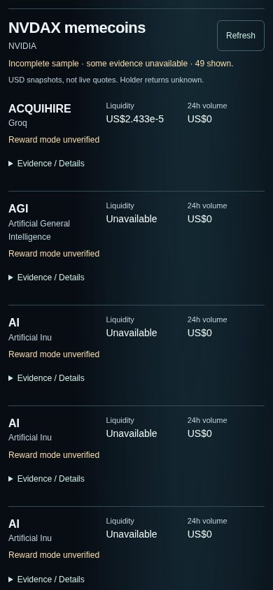
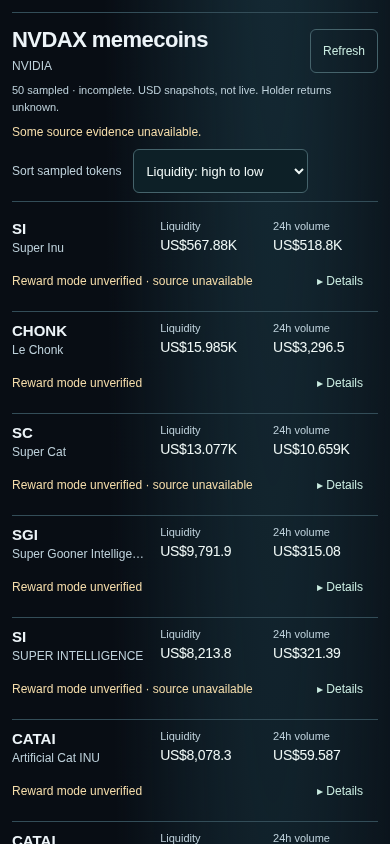

# Compact pair results — Issue #50

Results-only change from main `5203321f3e27f59cf144cc8cf134ba668261bf04` (merged homepage PR #49). Homepage markup, copy, featured mint candidates, verification, selection, search and request effects are unchanged. Landing captures match main pixel-for-pixel at 320, 390 and 1280px. No backend, API contract, source adapter, dependency, data, archive, collector, workflow or deployment changes.

## Before / after

Actual Chromium production-app screenshots, 844px viewport height, NVDAX selected. No intercepted API responses, fixture data, edited images or stitched screenshots. Results are scrolled to the selected-pair heading so the result density can be assessed. These are browser viewport checks, not physical iPhone testing.

| Viewport | Before: symbol order on main | After: liquidity high to low | After: default name A–Z |
| --- | --- | --- | --- |
| 320px | [Before](screenshots/pair-results-before-320.png) | [After, first five complete](screenshots/pair-results-after-320.png) | [Name order](screenshots/pair-results-after-name-320.png) |
| 390px | [Before](screenshots/pair-results-before-390.png) | [After, first five complete](screenshots/pair-results-after-390.png) | [Name order](screenshots/pair-results-after-name-390.png) |
| 1280px | [Before](screenshots/pair-results-before-1280.png) | [After, first five complete](screenshots/pair-results-after-1280.png) | [Name order](screenshots/pair-results-after-name-1280.png) |

At 390px, the first five baseline rows average 147.6px (144–163px); the new rows are 102px, about 31% shorter. The fifth baseline row ends at y=869, below the 844px viewport. The fifth new row ends at y=720, despite the new sort control. All first five fit at 320 and 1280px too. Long names can ellipsize; their complete text remains in the accessibility tree and Details. Rows grow when text is enlarged; density is not enforced by clipping.

Expanded evidence was captured separately from a later genuine response; it can differ as the provider changes. [Expanded real evidence at 390px](screenshots/pair-results-after-details-390.png). Homepage preservation: [320 before](screenshots/pair-results-before-home-320.png) / [after](screenshots/pair-results-after-home-320.png), [390 before](screenshots/pair-results-before-home-390.png) / [after](screenshots/pair-results-after-home-390.png), [1280 before](screenshots/pair-results-before-home-1280.png) / [after](screenshots/pair-results-after-home-1280.png).

## Source truth and behavior

The [before packet](evidence/pair-results-before.json) was captured at 21:48 UTC on October 14, 2026; the [after packet](evidence/pair-results-after.json) at 21:54 UTC. They are independent real responses, not synchronized market observations: baseline returned 49 identities with a duplicate-record warning; after returned 50. The sample still comes from at most two provider-selected market-cap pages of 25 for exact quote mint `Xsc9qvGR1efVDFGLrVsmkzv3qi45LTBjeUKSPmx9qEh`. Neither complete nor atomic coverage is asserted. Different ordering in the liquidity comparison is intentional; the default-name images are also provided for comparison.

The final after capture has 12 unavailable reward-mode checks and 38 catalog-only modes. It therefore shows **unverified**, including explicit source failures, rather than reusing the six verified modes in the earlier baseline response. This is genuine degraded-source evidence. No verified reward/activity state was fabricated for screenshots. The bounded live response can change on refresh.

Each row shows symbol/name, sourced USD liquidity, sourced reported 24h USD volume, and one reward-evidence sentence. A single sample notice states incomplete coverage, snapshot/non-live basis and unknown holder returns. A separate material source/stale/degraded warning stays visible. Registry verification is distinct from reward-mode verification; verified mode is distinct from observed flow. Recorded amounts, actual intervals, matched-period evidence, dates, revisions, source links, exact token/quote/pool addresses and unavailable-return caveats remain in Details. The reward-and-Details line is one native disclosure, with its complete token identity in the accessible name.

Default sort is **token name A–Z**, then symbol and mint. Liquidity and 24h volume sort descending on the raw finite reported USD values, with genuine zero before unavailable, then the same name tie-break. Sorting clones and filters the current list to the selected exact quote mint. It never fetches more pages, mixes quotes, ranks rewards or ROI, or claims the most liquid token in the whole market. Existing API scope proof, exact identity joins, source allowlists, freshness, gap/reset and comparable-period gates remain authoritative.

## Critical five-second / cold-user review

This is an agent heuristic review of the actual captures, not a timed participant study or a claim of another human iPhone pass. Human review remains pending.

| Cold-user task | What the screen supports | Critical assessment |
| --- | --- | --- |
| Find the most liquid sampled NVDAX token | Choose “Liquidity: high to low”; largest reported value becomes the first row. The captured example is SI / Super Inu. Scope says sampled and incomplete. | Clear after one sort choice; default name order deliberately makes no “best” claim. The native menu costs an action. “Most liquid” applies only to this fetched snapshot sample, with unavailable values excluded. |
| Tell verified reward evidence from unavailable evidence | One sentence per row distinguishes mode verified/no history, mode verified/recorded flow, unverified/source unavailable, stale or invalid history, and verified standard mode. | The actual final top five have **no verified reward modes**. They honestly cannot answer who has verified payouts. Isolated tests exercise verified states, but they are not substituted into the screenshots. “Mode” may still need explanation; Details separates mechanism from recorded counter changes and holder returns. |
| Find source evidence without understanding a quote mint | The 44px reward/Details line opens native evidence. Official catalog/mode links and the dossier are in that disclosure. | Clear action with no address knowledge required. Evidence remains dense and requires vertical scrolling; exact identity and source auditing are advanced tasks. Dossier/source access requires opening Details then tapping the link. |

Remaining friction: long names truncate on narrow screens; identical symbol/name tokens require Details to distinguish full mints. Repeated amber unverified states are visually monotonous but reflect the source. At 320px the sort control wraps and some reward states use two text lines. Desktop retains the existing centered content width. These are acceptable scope tradeoffs for review, not proof that conversion or understanding improved in a real study. No returns, complete coverage or reward eligibility is inferred.

## Verification

Executed on Node 24.19.0 / npm 11.9.0:

- `npm ci --cache /tmp/scout50-npm-cache` — passed, lockfile unchanged.
- `npm test` — passed: 188 JavaScript cases, 62 Python tests, 15 scheduler cases. New coverage includes exact-mint bounded sorts, immutable input, deterministic ties, zero/null/unavailable/non-finite values, and distinct reward/quality states. Existing financial and identity gates still pass.
- `npx tsc --noEmit`, `npm run lint`, `npm run build` — passed. Existing Next edge-runtime static-generation warning remains.
- `bash scripts/archive-tool.sh check origin/main` — append-only/reproduction check passed.
- `npm run archive:dry-run` — [11 checks passed](evidence/pair-results-archive-dry-run.json); disposable replay only, working archive unchanged.
- `SCOUT_VERIFY_ENV_PROXY=1 npm run verify:release -- --base http://127.0.0.1:3153 --target preview` — [local production-build smoke passed](evidence/pair-results-release-local.json). Read-only GET/hash/metadata checks of existing archive routes; not a deployment or public-site verification.
- `python3 tests/pair-results-browser.py --base http://127.0.0.1:3153 --axe /tmp/scout-qa/package/axe.min.js` — [42 browser checks](evidence/pair-results-qa.json). Genuine source checks plus separately labeled fixture cases. No fixture screenshots.

Browser checks cover 320/390/1280px, first five visible, identical landing captures, no selection-time regression/fanout, sorting membership and no additional requests, native keyboard Enter/Space/Tab, skip link, source/dossier links, 44px targets, closed/open disclosure semantics, 200% zoom including expanded evidence without overlap, no horizontal overflow or browser exceptions, and axe-core 4.10.3 WCAG A/AA rules (zero violations). Isolated cases cover true zero versus null, unverified/verified/standard mode, stale/invalid history, degraded source, 429/503, empty sample, wrong selected identity and forged scope. Automated checks do not replace actual VoiceOver or physical-device testing; those remain pending human review.

Reproduce captures with `python3 tests/pair-results-capture.py --base http://127.0.0.1:PORT --phase after`. Before capture used the same local production method at the pinned main commit before implementation; copy the capture script outside the checkout to reproduce `--phase before` on that commit. Use `NODE_USE_ENV_PROXY=1` only where required by the managed network; retain proxy/CA settings. Run the app as a fresh local production process for a cold source read, then reuse its warm NVDAX sample. Axe/Playwright/Chromium are QA-environment tools, not new app dependencies.

Rollback: revert this frontend/results PR through human review. No migration, external write, deployment or data rollback is involved. Feature branch and PR only; no merge or deployment performed.
