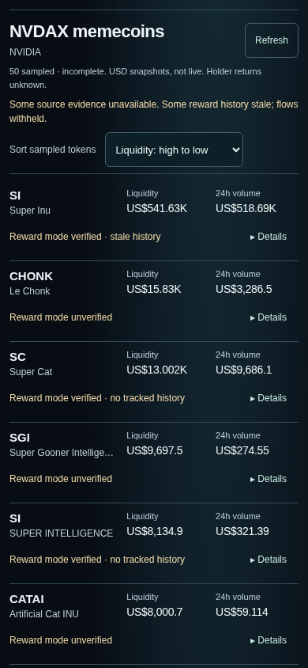
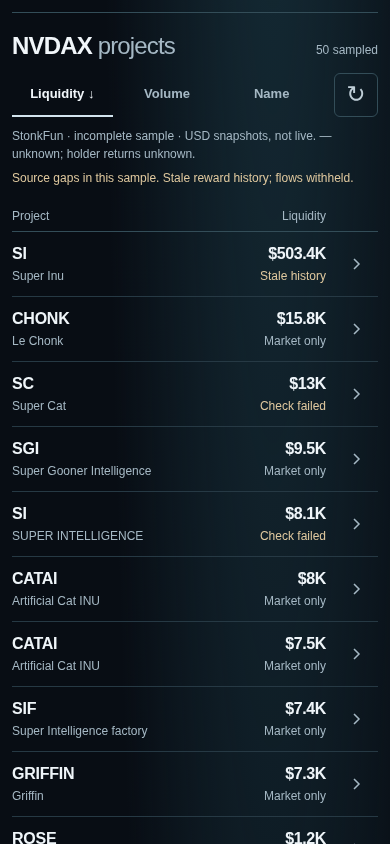

# Pair results screener — #55

Frontend-only work from `b8dc83c87ce4c3526cff4a2a2806dc2a46d8566e`, including merged PRs #52 and #53. The tested landing headline, verified chips, search, mint verification and request effects are unchanged. Landing screenshots match main byte-for-byte at 320/390/1280px. No backend, API, lib, data, collection, scheduler, Cloudflare, wallet, treasury, trading or dependency changes.

## What changed

Selected results now use shared column labels and quiet two-line rows: symbol/name, aligned reported amount, one short evidence state, and a 44px Details chevron. The project name is a separate 44px dossier link. There are no repeated metric labels, nested scan cards, unavailable-value blocks or reward-mode sentences in the list.

Default is reported liquidity descending **within the returned exact quote-mint sample**. Volume and name remain one-button local sorts with a visible pressed state/direction. Desktop shows liquidity and reported 24h volume together. At mobile widths the active metric takes priority: liquidity for liquidity/name sorts, 24h volume for volume sort. Both are always in Details. This follows #55's mobile priority rather than shrinking three financial columns into tiny text.

One notice names StonkFun, incomplete sampling, reported non-live USD snapshots, the unknown-value dash and unknown holder returns. Material source gaps/history degradation remain visible near the list and on affected rows. `Market only` means reported market evidence with unverified rewards; `Mode checked` means a verified mechanism without usable distribution evidence; `Flow recorded` requires the existing history gates. Stale/invalid history, identity issues and failed checks remain explicit. Neutral markers are neither investment scores nor payout badges. Their explanations are available to assistive technology, on hover, and in Details/the source legend.

Reported zero stays `$0`; unknown is `—` with an accessible “Unavailable” reading. Small positives use scientific notation before they could round to zero. Scan amounts use compact rounding; greater precision, raw source links, actual intervals, full mints, dates, revisions, unsupported return fields and all financial caveats stay behind Details. Existing source/identity/freshness/gap/reset gates are unchanged. No whole-market rank, return comparison, “Pair leaders” or earnings leaderboard is introduced.

## Genuine before / after

NVDAX selected, real production builds and real upstream packets, 844px browser viewport height. Before is latest main with liquidity sort explicitly selected; after is the new default liquidity sort. No request interception, fixtures, overlays, image editing or stitching were used for these captures. They are separate source snapshots, **not a market-performance comparison**: provider figures and check availability changed between runs.

| Width | Main / before | New / after | New volume view |
| --- | --- | --- | --- |
| 320 | [Before](screenshots/pair-screener-before-320.png) | [Six complete rows](screenshots/pair-screener-after-320.png) | [24h volume](screenshots/pair-screener-after-volume-320.png) |
| 390 | [Before](screenshots/pair-screener-before-390.png) | [Six complete rows](screenshots/pair-screener-after-390.png) | [24h volume](screenshots/pair-screener-after-volume-390.png) |
| 1280 | [Before](screenshots/pair-screener-before-1280.png) | [Six complete rows](screenshots/pair-screener-after-1280.png) | [24h volume](screenshots/pair-screener-after-volume-1280.png) |

At 320/390px, rows fell from 102px to 65px (36% shorter). At 1280px they fell from 100.5px to 65px. The first six new rows end at y=640/622/604 respectively. The sixth baseline row at 320px ends at y=860 and is partly clipped by the 844px viewport. Rows can grow for enlarged text; content is never forced into a clipped 65px box.

| Before — 390px | After — 390px |
| --- | --- |
|  |  |

[Expanded genuine Details](screenshots/pair-screener-after-details-390.png). Untouched landing comparisons: [320 before](screenshots/pair-screener-before-home-320.png)/[after](screenshots/pair-screener-after-home-320.png), [390 before](screenshots/pair-screener-before-home-390.png)/[after](screenshots/pair-screener-after-home-390.png), [1280 before](screenshots/pair-screener-before-home-1280.png)/[after](screenshots/pair-screener-after-home-1280.png).

The [baseline packet](evidence/pair-screener-before.json) began at 22:35 UTC on October 14, 2026; the [after packet](evidence/pair-screener-after.json) at 22:42 UTC. Both returned 50 unique NVDAX-quote projects through the existing two-page/25-record bound. Both disclose incomplete, non-atomic coverage and unknown market observation times. Baseline had seven verified modes/five unavailable checks; after had one verified mode/eleven unavailable checks; 38 records were catalog-only in each. The tracked SI history was genuinely stale. Screenshots preserve those limitations rather than manufacturing attractive success states. Details was captured separately from a later real response and may differ.

## Critical five-second review

Agent heuristic review of the actual views, not a timed participant study or a claim of physical-iPhone success:

| Task | Result and remaining friction |
| --- | --- |
| Choose NVDAX, find the largest reported liquidity in this sample | The familiar selector is unchanged; liquidity is already active and the largest reported value is the first row. No menu or unexplained score is required. This says nothing about tokens outside the bounded provider sample. |
| Compare activity | One tap on Volume switches both the local order and the mobile column title to “24h volume”. It is clearly reported market activity. Mobile cannot compare both figures simultaneously without Details; that is the deliberate readability tradeoff. |
| Pick a project | Symbol/name form a 44px link to its existing dossier. The chevron independently expands evidence. A cold user could initially read the chevron as dossier navigation; the two actions need physical-phone validation. |
| Understand evidence and limits | StonkFun and incomplete/non-live scope appear above the rows. “Stale history” and “Check failed” are visible without implying no rewards. “Mode checked” is less noisy than the old sentence but still needs interpretation; Details explicitly separates mechanism, recorded flow and holder returns. |

The list is materially quieter and its figures align, but identical token names still require Details for full mint identity. Long names truncate at 320px, while full names remain in the accessible link and Details. Compact rounding hides small differences; sorting uses the raw reported values and Detailed source evidence remains available. The primary source notice is compact, not a replacement for reading financial limitations. Conversion and comprehension improvements have not been measured in a human study.

## Accessibility and verification

Passed on Node 24.19.0/npm 11.9.0: `npm ci --cache /tmp/scout55-npm-cache`, `npm test` (259 JavaScript, 62 Python and 15 scheduler cases), `npx tsc --noEmit`, `npm run lint`, `npm run build`, `bash scripts/archive-tool.sh check origin/main`, `npm run archive:dry-run`, and read-only local `verify:release` smoke. Existing Next edge-runtime static-generation warning remains. No lockfile change. [Command record](evidence/pair-screener-checks.json), [archive replay](evidence/pair-screener-archive-dry-run.json), [local smoke](evidence/pair-screener-release-local.json).

[45 browser checks](evidence/pair-screener-qa.json) passed across 320/390/1280px. Genuine checks cover landing preservation, six complete rows, USD value correspondence within declared display rounding, responsive column labels, default liquidity/volume/name sorting with identical sample membership and no extra requests, 44px dossier/disclosure/source targets, semantic USD labels, skip link, keyboard Enter/Space/Tab/Escape, focus return, touch emulation, hidden/open evidence and 200% zoom without horizontal overflow or overlap. Axe-core 4.10.3 WCAG A/AA rules found zero violations; no browser exceptions. Labeled isolated cases cover zero/null, mode/flow distinctions, stale/invalid/degraded evidence, long Unicode identity, 429/503, empty sample, substituted quote identity and forged scope. Fixtures were never photographed.

Run `python3 tests/pair-screener-capture.py --base http://127.0.0.1:PORT --phase after`, then `python3 tests/pair-results-browser.py --base http://127.0.0.1:PORT --axe /PATH/axe.min.js`. The before captures used the same browser method at the main pin before implementation; copy the capture script outside that checkout to reproduce `--phase before`. Use a fresh local production process then reuse its warm NVDAX cache. Respect inherited network/CA configuration; `NODE_USE_ENV_PROXY=1` is only for managed egress. Playwright, Chromium and axe are QA tools, not app dependencies.

**Physical-phone/VoiceOver QA is pending.** No physical iPhone or iOS VoiceOver runtime is attached. Chromium viewport/touch checks do not establish Safari behavior. Human checklist on the review build: select NVDAX; identify sampled liquidity order; tap Volume and identify its 24h basis; open a project by name; expand/close Details with touch and VoiceOver; distinguish stale/check-failed from verified mode and actual recorded flow; follow the catalog source; confirm six-row density, 44px targets and text enlargement; confirm quote mint in Details without mistaking token ownership for an underlying stock. Record device/browser, target commit, UTC and observations. This PR is not blocked on a fabricated phone-test PASS.

## Read-only integration boundary for #54

This frontend does not import offline Pair Pulse or assume an endpoint from backend #54. Merged #53's inability to support comparative returns remains authoritative. Current `/api/pairs?quoteMint=…&discovery=pair`, registry and Radar contracts, strict parser, exact token/quote/pool joins, source provenance, cache/rate limits and fetch effects are untouched. No new route or automatic request was added.

A future optional audited-source extension should be reviewed against the typed contract provided by Agent A. Add validated source identity, status, coverage and actual observation-time evidence to the existing Details surface; keep old packets readable and current raw-metric sorting unchanged. Unknown, stale, degraded, identity-mismatched or unsupported evidence must stay gated. Audited market data alone does not verify reward distributions, holder attribution, synchronized returns or complete-market rankings. No speculative fields, mock API consumer or “leaders” module is shipped here.

Rollback: revert this frontend PR through human review. No migration, collection, workflow, external-state rollback or deployment is involved. Feature-branch PR only; no merge/deploy performed.
