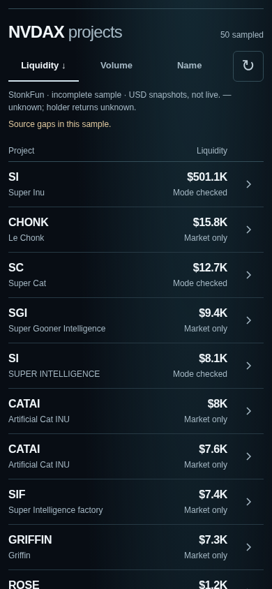
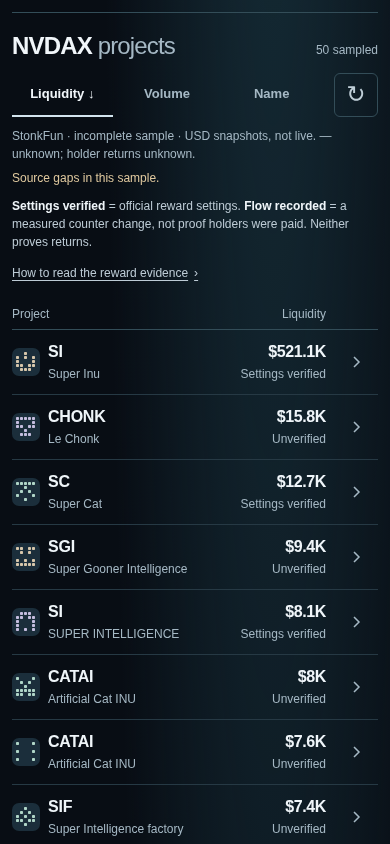

# Issue #59: reward clarity and research links

Frontend only, based on main `49ab560dde396d302f62dd21c7897379cccec75d` (includes PRs #56/#57). Human review only; no deployment or merge.

## What the screen establishes

Each row has one neutral state:

| State | Supported meaning |
| --- | --- |
| Settings verified | StonkFun's official response confirms reward settings for this exact token/quote identity. No usable interval flow is established here. |
| Flow recorded | Official reward mode plus a usable counter difference through the existing identity/source/freshness/reset/gap gates. Includes a genuinely recorded zero. Not verified payments to individual holders. |
| Unverified | No usable official reward-mode verification in this bounded sample. Does not establish that rewards are absent. |
| No reward mode | Official response confirms standard mode without a holder reward mechanism. |

An amber `!` identifies exceptional source/history quality; the row's accessible description and Details give the reason. A stale/invalid history does not erase a separately verified mechanism, but cannot establish usable flow. The existing sample-level degraded warning remains visible. No green investment badge, APR, ROI, universal ranking or inferred entitlement is introduced.

One persistent key separates settings from measured counter activity and holder payments. Its disclosure explains interval coverage, lifetime versus recent activity, genuine zero versus unknown, quote units, generated marks and research-link scope. Repetitive metadata stays in row Details: exact mints, source URLs, response/retrieval times, byte revisions, actual observation interval when usable, market snapshot limits and unsupported comparisons. This pair view does **not** acquire or display new lifetime payout data. The existing dossier may separately show API-reported cumulative totals; these do not establish recent flow, holder receipts or profit.

The first-screen selector/search and homepage components are untouched. Rows remain 65px. Default sampled-liquidity sort, volume/name sorts, stable sample membership and quote-mint boundaries are unchanged. At mobile widths the selected liquidity/volume column is displayed; desktop shows both, as on main.

## Genuine before/after evidence

All captures use the actual local production application and real upstream responses, with NVDAX selected: `Xsc9qvGR1efVDFGLrVsmkzv3qi45LTBjeUKSPmx9qEh`. Results are scrolled to the selected-pair heading. PNGs are unmodified Chromium captures, not composites or mocked data. Screen sizes are CSS viewport pixels at device scale 1, not claims of physical iPhone testing.

| Width × height | Main before | This branch after |
| --- | --- | --- |
| 320 × 844 | [Before](screenshots/reward-clarity-before-320.png) | [After](screenshots/reward-clarity-after-320.png) |
| 390 × 844 | [Before](screenshots/reward-clarity-before-390.png) | [After](screenshots/reward-clarity-after-390.png) |
| 1280 × 844 | [Before](screenshots/reward-clarity-before-1280.png) | [After](screenshots/reward-clarity-after-1280.png) |

390px before:



390px after:



[Expanded explanation at 390px](screenshots/reward-clarity-after-key-390.png) · [Expanded row research/source details](screenshots/reward-clarity-after-details-390.png) · [390px volume view](screenshots/reward-clarity-after-volume-390.png).

The [before recording](evidence/reward-clarity-before.json) and [after recording](evidence/reward-clarity-after.json) contain capture times, genuine source payloads, source revisions, coverage and six-row geometry. Before began at 2026-10-15 00:01 UTC; after has its own timestamp. These are independent moving source captures: changes in USD snapshots between them are **not** price performance or reward returns.

The recorded sample contains 50 returned tokens from two bounded pages, 12 mode-check attempts, 7 verified reward modes, 5 unavailable mode checks and 38 catalog-only records. It is degraded, incomplete and non-atomic. No usable reward flow is shown in this real sample. The provider-reported total is not a completeness claim. All first six rows remain 65px and fully visible at each width. Homepage before/after PNG hashes match at 320/390px; 1280px differs only in 13 rounded-edge pixels by at most one RGB channel level. The QA comparator permits at most 0.01% changed pixels and one channel level, preserving the unmodified images and recording the exact differences.

## Research and sharing journey

Select NVDAX, then inspect two projects in the same bounded sample. The browser journey used Super Inu (`DEW9dSN6QpWyNthphCpMmAbZP1Q4cEKR9xQXAri98WDP`) and Le Chonk; their exact token/quote identities, source provenance and URLs are in the [QA recording](evidence/reward-clarity-qa.json). They were selected by reported sampled liquidity, not earnings. One can be officially verified while the other's reward setting is unverified.

Open Details, inspect the official mode/catalog evidence and timestamps, then open Token dossier or Copy research link. The copied URL is the existing `/?mint=<exact token mint>` route on the current origin. It shares the current individual dossier; it does **not** freeze figures, preserve the pair selection or encode a comparison. Name links keep the same dossier route.

Copy success is announced only after the clipboard promise succeeds. Missing/denied clipboard access exposes a labeled, selectable read-only URL and a truthful status message. Existing dossier metadata, real clipboard fallback, exact-mint reopen, native share payload, cancellation and denial are tested. The native picker is intercepted for payload testing; no report was sent externally and no social app was used.

**Social preview image delivery fails on existing main.** `/api/og?mint=DEW9dSN6QpWyNthphCpMmAbZP1Q4cEKR9xQXAri98WDP` closes the connection. A separate production build of the pinned, unchanged main reproduces the failure; [baseline evidence](evidence/reward-clarity-baseline-social-preview.json) records the identical API route source hash and Satori error: `Expected <div> to have explicit "display: flex" or "display: none" if it has more than one child node.` A dynamic font fetch also fails in this restricted environment. Token URLs/clipboard work; image previews do not pass. The browser QA finishes the independent frontend checks, records this failure, and exits **1**, rather than reporting an all-green share test. The API route is outside #59's allowed scope and remains untouched. [Reported to Agent A](https://github.com/fuzzysniper/scout-stonk-intel/issues/58#issuecomment-6181301361).

## Reader feedback and critical five-second review

The user supplied this response to the intermediate genuine 390px screenshot: **“Hasn’t verified much but memecoin icons would be sick (images) for ex.”** This is not a pass for comprehension or willingness to share: the reply did not distinguish verified settings from unverified holder payments, and did not endorse sharing. We cannot claim the human acceptance criterion has passed.

In response, the final label says **Settings verified**, replacing **Mode verified**, and the key states the limited meaning. Small deterministic SVG mint marks add visual recognition without changing row height or requests. The current contract contains no verified token-logo URL. The marks are expressly described as generated, not official logos or proof of identity; addresses/source gates remain authoritative. Dated offline audit imagery is not used as a production fallback. Actual memecoin artwork remains a sourced API follow-up, not fabricated branding.

Critical self-review (not a second human test):

- In five seconds, the selected quote, sampled liquidity, symbols and neutral evidence labels are scannable. The key names what was checked and what it cannot prove; real source gaps remain visible.
- At 320px, long names truncate; symbol, accessible link name, title and Details preserve full names. Marks add texture but cannot establish official branding or identity.
- Research/source access takes one disclosure. Copy has a clear success or selectable fallback; it is still a current-token link, not a frozen two-project report.
- This is a limited research sample, not a verified earnings screener. Empty flow evidence is honest but limits the product's immediate usefulness. Generated marks alone do not solve shareability.
- A new cold-reader check of **the final Settings verified version**, physical iPhone/VoiceOver testing and a real social-app preview check after the API fix remain pending. Do not call shareability solved while the preview image fails.

## Checks and reproduction

Commands run from the worktree:

```sh
npm ci --cache /tmp/scout59-npm-cache
npm test
npx tsc --noEmit
npm run lint
npm run build
bash scripts/archive-tool.sh check origin/main
npm run archive:dry-run
SCOUT_VERIFY_ENV_PROXY=1 npm run verify:release -- --base http://127.0.0.1:3162 --target preview
python3 tests/reward-clarity-capture.py --base http://127.0.0.1:3162 --phase after
python3 tests/reward-clarity-browser.py --base http://127.0.0.1:3162 --axe /tmp/scout-qa/package/axe.min.js
```

The local server uses `NODE_USE_ENV_PROXY=1 npm run start -- --hostname 127.0.0.1 --port 3162`. Chromium, axe 4.10.3, Playwright and Pillow (pixel comparison only) are environment tools; no package or lockfile change. Network-enabled execution is needed for Chromium sockets, Miniflare's local tests and real upstream reads. No collector or Cloudflare command is run.

The [QA recording](evidence/reward-clarity-qa.json) covers 55 frontend checks: all three widths, zero overflow, real sample sorts without request fanout, 44px controls/links, keyboard Enter/Space/Tab/Escape, touch disclosure, 200% zoom, WCAG A/AA axe scans, official source links/exact identities, actual clipboard round trips and dossier reopening. Twelve isolated state variants at each width test zero/null, reward states, stale/invalid/degraded histories, long Unicode names, 503, 429, empty sample, quote identity mismatch, forged scope and missing mode proof; two capability fixtures test clipboard denial/absence. Fixtures are explicitly isolated, never screenshot sources. Source gates and safe zero/flow calculations also have unit coverage.

Release smoke checks the existing release/archive surfaces; it does not replace the separate failing token social-image test. Full command outcomes and boundaries are recorded in [verification evidence](evidence/reward-clarity-verification.json).

## Agent A integration and scope

[Initial #58 coordination](https://github.com/fuzzysniper/scout-stonk-intel/issues/58#issuecomment-6181130549), [Agent A's typed proposal](https://github.com/fuzzysniper/scout-stonk-intel/issues/58#issuecomment-6181141742), and [preview/logo follow-up](https://github.com/fuzzysniper/scout-stonk-intel/issues/58#issuecomment-6181301361).

This PR consumes only the merged contract: `modeVerification`, `rewardModeVerified`, `rewardSource`, existing history/radar fields, market snapshots and dataset coverage. No schema, adapter or API change. Future optional `rewardEvidence` mechanism/lifetime/interval/holder-return data from #58 must be integrated in a separate reviewed PR after merge, with exact mint/pool identities, units, source dates/revisions, interval gates and null unsupported returns preserved. A future logo response would also need exact token-mint binding, provenance and safe missing/untrusted-image handling; no new imagery endpoint is assumed here.

Production edits are limited to `app/pairs/explorer.tsx`, `app/pairs/results.ts` and selected-results CSS. Other changes are frontend tests and documentation/evidence. Homepage, first-screen selection, lib/API, real snapshot data, collector/scheduler, Cloudflare and financial operations are unchanged. Rollback is reverting this frontend PR; no data migration or external state needs undoing.
