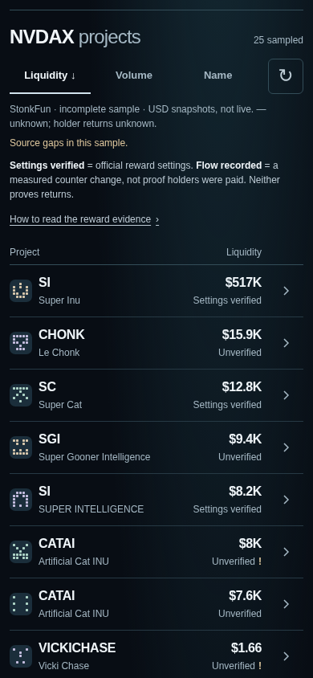
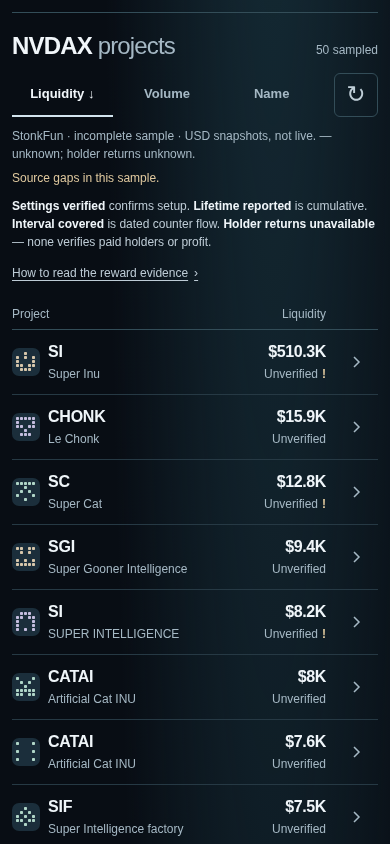

# PR #60: merged reward-evidence integration

This continues the existing frontend PR after rebasing onto main `f269ce3`, including merged backend PR #61 (`c50569b`) and Agent A's OG fix #63. It consumes optional `PairToken.rewardEvidence` without editing lib/API, the frontend adapter, source requests, actual application data or reward mathematics. [Backend contract and methodology](REWARD_EVIDENCE.md). [Separate before/after OG status and post-merge validation](OG_QA_STATUS.md).

## Compact screen and evidence meaning

The homepage, pair selector/search, 65px row geometry, default sampled-liquidity ordering, volume/name sorts and exact quote-mint boundaries are preserved. Only one neutral evidence label appears per row; financial amounts remain the sourced USD liquidity/volume snapshots. Reward amounts and their full provenance are one disclosure deeper.

| Contract state | Row label | Meaning in Details |
| --- | --- | --- |
| `interval.state: covered` | Interval covered | **Covered interval flow:** current and previous adjacent 24h counter windows passed the unchanged backend Pulse gates. Exact actual/provider boundaries, seconds, observations, maximum gaps, raw amounts and original history/mode/catalog receipts remain visible. Counter activity is not reconciled holder payment. |
| `lifetime.state: reported` with no covered interval | Lifetime reported | **Reported lifetime distribution:** the cumulative provider ledger total in exact quote-token units. Start and reconciliation cutoff are unknown. Original generation/retrieval, raw integer, decimals, reported event/recipient counts and last reported payout time are distinct fields. Not a recent earning rate. |
| `mechanism.state: verified_reward` without usable amounts | Settings verified | Official settings and exact mint identity only. No distribution amount or holder receipt is inferred. |
| `mechanism.state: verified_standard` | No reward mode | Official standard mode, without a holder reward mechanism. |
| Unverified or malformed optional evidence | Unverified | Missing/stale/unavailable claims are withheld; malformed optional evidence does not regain a stronger legacy label. |
| `holderReturn: unavailable/null` | One persistent key: Holder returns unavailable | Holder entitlement, costs and cashflows are missing. No paid-holder verification, ROI/APY, earning score or universal ranking. |

The persistent key uses the same short labels and explains all four distinctions. Its native disclosure expands the meanings, zero/unknown handling, generated-mark limits and exact-token research-link scope. Material exceptional quality keeps an amber `!`, accessible description and its specific reason in row Details. A valid settings check can coexist with unavailable lifetime/interval evidence. A partial catalog can support a named token's reported lifetime value without supporting complete coverage or any covered interval.

Lifetime/interval values stay canonical decimal **strings**; they are never converted through JavaScript floating-point numbers or annualized. A genuinely reported lifetime or interval zero remains zero, with no inference that a holder was paid. Null values remain unavailable. Source retrieval/evaluation times are never substituted for actual payout/observation boundaries. The current-minus-previous counter difference is labeled as such, not a return.

## Frontend boundary and legacy compatibility

`readRewardEvidence` in `app/pairs/results.ts` validates the optional object against the already validated selected catalog. It checks the exact token/quote mint, symbol/registry decimals, source receipt/revision membership, fixed lookup URL, source dates as of the server evaluation, state/value consistency, canonical raw/string amounts, ledger bounds and counts, window continuity/metadata, history revision, unknown holder returns, incomplete/non-atomic scope and withheld rankings. It does not request providers or recalculate history from fabricated points; the backend's strict eligibility gates remain authoritative. A dated genuine wire-response replay and an isolated partial-source unit case verify supported cumulative values without turning that recording into a current fallback. The final live browser capture honestly withholds all current reward amounts.

Absent field means an older compatible response: use dated legacy settings; no new lifetime or covered-interval figure is inferred. Gated legacy counter observations remain separately labeled **Legacy recorded counter change** in Details, with their actual interval; they cannot promote the row to Interval covered. Present-but-invalid/null/unknown-version optional evidence is different: show Unverified with a validation warning, withhold optional values and retain the independently sourced market row. A present explicit stale/unavailable result takes precedence over legacy flags. Tests include an old `rewardModeVerified: true` with newly stale evidence; it stays Unverified.

Only type imports refer to the merged lib contract. Production integration edits are in `app/pairs/explorer.tsx` and `app/pairs/results.ts`; existing PR CSS/mint marks stay unchanged. No backend/lib/API/OG, data, collector/scheduler, workflow, Cloudflare, wallet or treasury edits.

## Genuine before/after and critical review

Before is the previous PR #60 UI rebased onto #61 (local `8c579fd`: original PR patch `e574dfc` atop `c50569b`), built separately from a git archive before integration edits. After is the final integrated UI on merged #63. Both use real production requests with exact NVDAX mint `Xsc9qvGR1efVDFGLrVsmkzv3qi45LTBjeUKSPmx9qEh`. No route interception, injected values, image editing or fixture screenshots. The scripts preserve the earlier `reward-clarity-*` evidence and use a distinct `reward-integration-*` prefix.

| Viewport | Before | After |
| --- | --- | --- |
| 320 × 844 | [Before](screenshots/reward-integration-before-320.png) | [After](screenshots/reward-integration-after-320.png) |
| 390 × 844 | [Before](screenshots/reward-integration-before-390.png) | [After](screenshots/reward-integration-after-390.png) |
| 1280 × 844 | [Before](screenshots/reward-integration-before-1280.png) | [After](screenshots/reward-integration-after-1280.png) |

390px before:



390px after:



[Expanded key](screenshots/reward-integration-after-key-390.png) · [Real reward/source Details](screenshots/reward-integration-after-details-390.png) · [Volume view](screenshots/reward-integration-after-volume-390.png).

[Before source/geometry recording](evidence/reward-integration-before.json) began at 2026-10-15 00:53:26 UTC: only 25 rows from one of two bounded pages because a page was unavailable; 11 mode-check attempts, three reported lifetimes in the response, but the old UI did not consume them. [Final after recording](evidence/reward-integration-after.json) began at 01:09:47 UTC: 50 rows from two bounded pages and 12 mode-check attempts. All 50 are Unverified: 11 stale mode sources, one unavailable source and 38 unchecked modes. No current lifetime amount, covered interval or holder return passes. The sample remains degraded, incomplete and non-atomic. These are independent changing source captures, not a fixed-universe return comparison or evidence that this frontend increased coverage. The first six rows remain 65px and fully visible at every width; raw identities, receipts, coverage and geometry are preserved in the recordings.

The real journey still opens SI and CHONK evidence and exact existing dossier links. Links share the current individual token dossier, not a frozen pair sample or two-token comparison. The dossier/OG uses its existing independent source surfaces and may report different market/lifetime values or quality from this selected-pair response; no row value or timestamp is copied into the URL or treated as the dossier's evidence. Clipboard denial/missing capability has a selectable exact-URL fallback, and native share testing stubs the picker without sending a report externally. The merged Agent A token OG image is tested separately, never conflated with reward evidence.

Critical five-second self-review, not a human acceptance pass:

- Lifetime reported is visibly different from Settings verified and Unverified while preserving the compact market scan. The key explicitly says cumulative and unavailable returns; no positive-rate badge or green profit state appears.
- The final live capture supports no reward amounts because current source checks fail or were not attempted. It cannot answer recent earning pace, eligible holder payments or ROI. Opening Details exposes this limit and the original source state. A dated packet with three supported lifetime totals is replayed only as an offline unit regression, never a production fallback or current claim.
- At 320px, long names truncate; accessible names, titles and Details preserve full identity. The longer key adds one text line while six rows remain visible. Generated mint marks remain visual aids, not official token artwork or identity proof.
- Full interval display is tested only with clearly synthetic covered/zero fixtures; the genuine source sample supplies none. Do not present those fixtures as live screenshots or claim live interval availability.
- Human comprehension of the final integrated screen, physical iPhone/VoiceOver testing and social-app unfurl validation remain pending. Prior feedback (“Hasn’t verified much ... memecoin icons ...”) is not a pass for these acceptance criteria.

## Validation and reproduction

Completed locally on merged #63: 421 app JavaScript tests, 62 Python tests and 15 scheduler tests; zero failures. The full combined browser command passed 103 frontend checks plus the real OG probe (HTTP200, image/png, PNG signature and browser-decoded 1200×630 dimensions; exit 0). Pre-fix failure evidence is retained separately. These results do not claim a human comprehension pass, physical iPhone/VoiceOver test or physical social-app unfurl.

The homepage matches the previous PR's screenshot exactly at 390px. At 320/1280px only 6/13 rounded-edge pixels differ by at most one RGB channel level, within the recorded 0.01%/one-level rasterization tolerance; the images are unaltered.

`npm ci`, all app/Python/scheduler tests, typecheck, lint, production build, archive append-only/reproduction, archive dry-run and local release/archive smoke pass. The complete [verification record](evidence/reward-integration-verification.json) records actual command outcomes; [mobile/reward QA](evidence/reward-integration-qa.json) records each frontend check and the genuine expanded-row source payloads. The OG outcome has its own [probe record](evidence/reward-integration-og.json) and [unaltered image response](evidence/reward-integration-og-image.png). A failed image request still leaves full browser QA nonzero.

```sh
npm ci --cache /tmp/scout59-npm-cache
SCOUT_REWARD_UI_FIXTURES=/tmp/scout60-ui-fixtures.json npm test
npx tsc --noEmit
npm run lint
npm run build
bash scripts/archive-tool.sh check origin/main
npm run archive:dry-run
NODE_USE_ENV_PROXY=1 npm run start -- --hostname 127.0.0.1 --port 3176
# Other terminal; before was separately built/served on port 3173.
SCOUT_VERIFY_ENV_PROXY=1 npm run verify:release -- --base http://127.0.0.1:3176 --target preview
python3 tests/reward-clarity-capture.py --base http://127.0.0.1:3176 --phase after --prefix reward-integration
python3 tests/reward-clarity-browser.py --base http://127.0.0.1:3176 --axe /tmp/scout-qa/package/axe.min.js --prefix reward-integration --reward-fixtures /tmp/scout60-ui-fixtures.json
```

Synthetic frontend scenarios are generated with the merged backend and an offline synthetic fetcher through `tests/reward-evidence-ui-fixtures.mjs`. The optional `/tmp` export is only test input. It includes covered/zero windows, lifetime/zero/precise strings, settings-only, standard, stale source/evaluation/lifetime and 429. Mutations cover invalid mint/source/return/amount/null evidence. All three widths exercise sorting without requests, source Details, 200% reflow, keyboard/touch, 44px targets and axe A/AA. Network permission is needed for local Chromium/Miniflare sockets and the genuine app's bounded upstream reads; no provider budgets or app requests are widened. Environment tools only: Playwright, Chromium, axe 4.10.3 and Pillow; no dependency change.

Rollback is reverting the integration commit to return to the previous #60 UI; reverting the entire feature PR restores main's frontend. No migration or external financial state needs undoing. PR #60 remains human-review only; no merge, deployment or activation.
