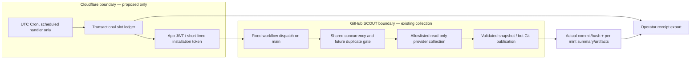

# ADR 0001 — independent collection trigger (proposed, inactive)

Status: **proposed for human review; no activation authorized**. Issue [#24](https://github.com/fuzzysniper/scout-stonk-intel/issues/24). Base main `8012318bce8a1a21a96a5ce87afe74586760c77a`, including merged PR #23. This decision and threat model were written before preparatory code.

## Decision and alternatives

Recommend a **conditional 48-hour pilot of one Cloudflare Cron Worker + SQLite-backed Durable Object + GitHub App**, while keeping provider collection, allowlist validation and Git publication in the existing GitHub workflow. An independent clock is warranted for a pilot because [PR #23's evidence](../COLLECTOR_RELIABILITY.md) shows 3 scheduled creations over 25 nominal opportunities, despite successful observed collection/persistence. It removes dependence on GitHub's cron emitter, **not** on GitHub API availability, runner capacity, provider health or branch rules. No option supplies an unconditional hourly guarantee.

| Option | Privileges/credential | Cost and tradeoff | Decision |
| --- | --- | --- | --- |
| Existing Actions cron + operator dispatch | Current ephemeral workflow token; human repo access, no added secret | Standard public-runner compute free; irregular creation already observed. Mobile operator can inspect/dispatch after separate authorization but cannot reliably cover every hour | Keep existing behavior now; honest fallback, no new timing claim |
| Generic hosted cron directly calling dispatch with PAT | Classic PAT needs `repo`; fine-grained PAT can limit repo/Actions write but is still long-lived bearer credential | Vendor price/retention unknown; simple HTTP schedules often lack atomic duplicate state. Rotation/mobile secret handling adds risk | Reject classic/broad PAT; do not choose anonymous public webhook or credential-in-URL |
| Cloudflare Cron + Durable Object + GitHub App | One private App, installed only on SCOUT; repository **Actions: write**, implicit Metadata read; **Contents: none**. App key in runtime secret store; repository-limited hourly installation tokens expire after 1h | Potential $0 under Free limits; tighter CPU limit; Paid baseline $5/month only with separate budget approval. Single managed ledger, no VM; ongoing inspection possible via dashboards | Preferred pilot candidate, gated on security, adapter/CPU tests and approval |
| GCP Cloud Scheduler → OIDC-authenticated broker → GitHub App | Scheduler service account only allowed to invoke the broker; broker holds App key, same repository-limited App permission | Independent managed trigger/retry; more IAM, broker/ledger/secret resources. Current account-specific total price and free allowances **unknown**, obtain quote before choice | Good alternative for an already-managed GCP account; not simpler here |
| AWS EventBridge Scheduler → IAM-constrained Lambda → GitHub App | Target invocation IAM role, narrow function/storage/secret grants; App key retained in secret manager | Independent trigger/dead-letter tooling; more IAM and resources. Scheduler, compute, ledger, secret/log costs **unknown**, price separately | Supported pattern, not first choice without existing infrastructure |
| External collector committing directly | External provider access plus Contents write key and independent validation/runtime | Larger trust boundary and credential blast radius; duplicates Git validation | Reject unless separately demonstrated safer |

An App's Actions write permission is **not workflow-specific**: a stolen key/token can trigger/cancel other Actions workflows in its installation repository. Do not install it on STORK Post Office or treasury repos. App least privilege is narrower than Contents write/PAT `repo`, not risk-free. Creating/installing this App is a future permission change requiring explicit authorization; none occurs here.

## Proposed trust boundaries

No public HTTP trigger, user-supplied repo/ref/workflow/URL, webhook listener, wallet, treasury or market signal enters this path. The trigger receives timing metadata only, never financial samples. No provider credentials or GitHub Contents write token leave GitHub. Owners secure dashboards with MFA; ongoing operation is mobile-led, but initial key handling may require a trusted workstation. Never send keys via chat, commit them, or log JWT/token/header/response bodies.

## Threat model and failure policy

| Threat/failure | Required control and evidence |
| --- | --- |
| App key or Cloudflare admin compromise | Install on one repo; Actions write only, explicit token scope; no Contents/Secrets/Variables/Admin grants; no webhook/public handler. Key rotation/revocation and account audit logs. A compromised runtime can exfiltrate its key; vault storage is not cryptographic confinement. Actions write can also delete Actions evidence; corroborate with protected Git commits and operator-held receipt exports |
| Forged target/ref or replayed event | Fixed `fuzzysniper/scout-stonk-intel`, `reward-snapshots.yml`, `main`; canonical minute-17 UTC slot. Reject future, malformed or >15m late events. Actor/install identity checks and declared slot inputs in future GitHub adapter; fixed HTTPS GitHub origin with TLS verification and no redirects |
| Duplicate delivery/concurrent invocations | Unique slot row, atomic transaction and reservation nonce; one winner. In-memory/KV eventual-consistency locks are insufficient. Preserve receipt across restart; bounded 8-day ledger retention, maximum 193 hourly rows. Keep transition nonce private; export its correlation hash, not the nonce |
| Lost response/crash during POST | Accepted 200/204 is terminal for dispatch. Timeout, connection loss, ambiguous 5xx or expired reservation is **uncertain**, never automatically re-POSTed. Expired lease does not prove no dispatch occurred. This may sacrifice a slot rather than risk duplicates |
| Explicit GitHub rate rejection | Only a confirmed no-dispatch rate-limit response permits one retry, with bounded Retry-After (1–300s), inside the original 15m window. Max two dispatch attempts/slot. 401/permission/invalid-config failures stop and require operator review; no blind credential replacement |
| Accepted dispatch but no job yet | Persist acceptance/run ID if supplied; bounded read-only reconciliation. API/listing failure is unknown. Never infer persistence from acceptance or green job; queue delay may still defeat hourly coverage |
| Provider timeout/partial failure | Existing per-mint sanitized reasons/actual times; persist successful real observations, keep failed mints missing. Do not redispatch the entire accepted slot to retry providers. Next genuine hourly collection is recovery; extra retries need separate evidence/review |
| Git conflict/audit overlap | Existing shared noncancelling concurrency; human pushes can still race. If main advances, stop publication, preserve candidate/summary artifacts, reconcile exact remote bytes; no force push/blind rebase/synthetic merge. Offline preflight refuses stale bases |
| Drift/downtime/backlog | Do not catch up past slots or invent counter history. Planned slot time is never `observedAt`/`providerGeneratedAt`. Actual collection timestamps and quote/source validation remain authoritative |
| Quota/storage outage/abuse | Fail closed without ledger; daily request/CPU/attempt caps, timeouts, bounded retention and operator circuit breaker. No automatic paid upgrade. Keep an independent read-only human check: the scheduler cannot report its own nonexecution |
| Duplicate native/manual/external collectors | External ledger alone cannot suppress native/manual workflow events. Before activation, implement/test a shared GitHub-side slot guard under existing serialization, with authenticated inputs and explicit operator exceptions; audit actual collected points, not just dispatches |

Exactly-once execution across network/ledger/GitHub cannot be guaranteed. An uncertain slot stays uncertain even if no run is found in an incomplete listing. A later fresh slot may proceed; missing earlier history remains missing. Existing strict comparison gates, quote identities, eight-day history retention and disabled archive publication are unchanged.

## Cost evidence and budget

Official documentation checked **2026-10-13 UTC**; [source ledger](../evidence/scheduler-source-review.json) records retrieved byte hashes/URLs. Numbers are planning estimates, not an account bill or an SLA.

- Workers Free: 100,000 requests/day, **10ms CPU/invocation**, 50 subrequests, 5 Cron Triggers/account. Cron changes can take up to 15m to propagate. One hourly cron is 24 events/day, 720 in 30 days or 744 in 31. App signing, JSON/ledger work and cold starts must fit the CPU limit in the real adapter; this PR does not benchmark Cloudflare. If they do not fit, require a separate $5/month Paid-plan approval or reconsider hosting, never silently upgrade.
- SQLite Durable Objects are available on Free: 100,000 requests/day, 13,000 GB-s/day, 5 million row reads/day, 100,000 writes/day, 5GB stored data. Plan at most four ledger operations per event (96/day) plus bounded reconciliation. At an assumed 15s active time/event and 128MiB allocation, duration is roughly 46 GB-s/day; actual duration is **unmeasured**. No persistent busy timer/WebSocket. A 193-row receipt ledger should be small, but real row/index overhead is **unknown until measured**.
- A normal event needs one installation-token request plus one dispatch; two bounded reconciliation reads give roughly 96 GitHub calls/day. One known rate-limit retry raises the upper dispatch bound to 48/day, not unlimited retries. Treat current GitHub rate headers and secondary limits as authoritative; do not use quota assumptions to retry ambiguous requests.
- GitHub confirms this repository is public. Standard `ubuntu-latest` public-runner compute is currently free, subject to policy/concurrency/service availability. If made private, GitHub Free includes 2,000 minutes/month and 500MB artifact storage shared with Packages; jobs round up to whole minutes. 720 subminute hourly jobs would use about 720 minutes/month, or up to 3,600 minutes at the existing five-minute timeout ceiling, plus audits/CI/other repos. Standard Linux 2-core overage is currently $0.006/minute; 720 minutes **above** allowance would be $4.32. Owner plan, other usage and actual billing are **unknown**.
- Current snapshot + summary is 16,737 bytes. At unchanged size, 168 hourly seven-day artifact copies are about 2.68MiB before compression; growth is expected. At the existing 2MiB source ceiling, snapshot copies alone can approach 336MiB/7d plus summaries/audits/logs/other artifacts. Public compute does not mean unlimited artifact storage. Keep existing retention/limits; do not enable archive jobs or buy storage here.

Primary sources: [Workers pricing](https://developers.cloudflare.com/workers/platform/pricing/), [limits](https://developers.cloudflare.com/workers/platform/limits/), [Cron](https://developers.cloudflare.com/workers/configuration/cron-triggers/), [Durable Objects pricing](https://developers.cloudflare.com/durable-objects/platform/pricing/), [GitHub billing](https://docs.github.com/en/billing/concepts/product-billing/github-actions), [App tokens](https://docs.github.com/en/apps/creating-github-apps/authenticating-with-a-github-app/generating-an-installation-access-token-for-a-github-app), [dispatch API](https://docs.github.com/en/rest/actions/workflows#create-a-workflow-dispatch-event). Official current OpenAPI documents `return_run_details:true` → 200 with run ID/URLs, or legacy 204 with no details; use a supported pinned API version and validate returned ID, never assume 204 means no run. The 2026-03-10 App permission table specifies Actions write.

## Safe preparatory implementation boundary

Implement only a **local SQLite reference contract**, default simulation disabled, for durable atomic slot claims, bounded duplicate suppression, uncertain outcomes, one confirmed rate-limit retry, retention/capacity and stale Git publication preflight. Use Python standard library, temporary databases and synthetic ops fixtures. Preserve genuine data and existing collector validation through regression tests. There is no HTTP client, credential loader, deployment configuration, runtime account, workflow edit or live dispatch path. The future Cloudflare adapter must implement/test the same transactional semantics; a local SQLite test is not proof of Durable Object behavior or live reliability.

## Setup steps — blocked on separate authorization

1. Review ADR, threat model, unknown costs, record operator/budget/rollback owner. Approve the actual App permission grant, hosting and pilot explicitly. Nothing in this PR is that approval.
2. In a separate adapter PR, implement scheduled-only Worker + SQLite Durable Object with atomic state transitions, deadlines, bounded writes and redacted evidence exports. Benchmark Free CPU including key import/signing/cold starts; verify quotas before any paid choice. Do not create a public fetch endpoint.
3. Before live operation, add/test authenticated slot inputs and shared duplicate gate in GitHub under existing concurrency. Persist/reconcile slot/run/candidate hash/accepted remote commit separately. Verify native/manual collisions and current API's run-detail response in an approved isolated setup. Do not activate external cron with today's ungated workflow.
4. Only after explicit approval: create a private GitHub App, disable webhooks, set Actions write/Metadata read only, install **only SCOUT**, record repository/installation IDs. Owner puts key in the selected runtime's secure secret store, not in chat/source. Mint one-hour installation tokens with explicit repository and Actions-only scope; validate returned installation/repository/permissions and treat token strings as opaque (no fixed-length assumption); preserve existing bot publication/branch rules and archive opt-in disabled.
5. Deploy approved adapter with activation/circuit breaker off, inspect static configuration and durable evidence storage. Only then approve enabling exactly one UTC hourly trigger. Remove public routes, cap CPU/requests and bound retries; verify that workflow default `main`, repo visibility and permissions have not drifted. Keep native cron as-is until shared-gate collision tests pass; changing/disabling it needs separate approval.
6. Start the proving window below; do not announce reliable hourly collection before passing. Mobile owners inspect ledger, run/commit links, stale data and quotas; key rotation/recovery may require a trusted workstation.

## 48-hour proving and rollback

After authorized activation, enumerate **48 consecutive UTC hourly slots**, planned/delivery/claim/dispatch/actual-job/actual-observation times and delays. Retain eight-day sanitized receipts plus seven-day Actions artifacts. A receipt export stores source slot, reservation correlation hash/attempt, accepted/uncertain/denied status, optional run ID and known-rate retry time; reconciliation separately links per-mint summary, exact candidate/main hash and commit. Evidence must be durable and exportable; retain an operator copy outside the ledger account when proving. Ledger hashes are not signatures or independent transaction verification. No private key/token/request body enters it.

Require at most one accepted dispatch per slot and no unintended duplicate collection across trigger sources; all attempts attributable, no unresolved acceptance/persistence, provider failures explicit, and actual maximum observation gaps <=2h with latest age <=3h. Target at least 47/48 slots creating a job within 15m; report exact observed count/delays and every exception, **not an uptime guarantee**. If a duplicate, unexplained conflict, quota failure, credential anomaly or gap violation occurs, pause pilot and investigate. Covered 24h/48h research comparisons still need their separate stricter gates; 7d remains unavailable until enough real history exists. Validate actual raw/served source revisions after existing cache expiry without redeploy; fetch freshness never replaces observation freshness. Test outages/duplicate delivery only in isolated approval scope; never synthesize production samples.

Rollback this preparatory PR via reviewed revert; no production resource exists to remove. After a future approved pilot: turn off external activation first, account for Cron deletion's propagation delay, preserve pending/uncertain receipts and all genuine observations/archives, revoke installation/key, then remove approved runtime resources. Leave the existing collector/native schedule/permissions intact unless separately reviewed. Never roll back a successful data commit, force push, replay missed slots or activate archive publication as recovery.

## Verification of this inactive preparation

Node 20.20.2/npm 11.9.0. `npm ci` exited 0 (310 packages). `npm test` exited 0: 109 JavaScript and 41 Python tests, no failures/skips; 16 new tests cover the local trigger contract. `npx tsc --noEmit`, `npm run lint` and `npm run build` exited 0. `bash scripts/archive-tool.sh check origin/main` passed. Existing ESLint installation deprecation and edge-runtime/static-generation build warnings remain. Concurrent claims use four real SQLite connections; restart, uncertain response/crash, bounded retry, paused circuit, receipt redaction, retention/capacity, provider outage/partial failure and timestamp/source identity are exercised offline. Publication preflight rejects main/hash/control changes; merged PR #23's real local Git-conflict regression remains in the full suite.

All data/allowlist/archives, workflows/permissions/enablement, collector/cadence audit, application/math and dependency files are byte-for-byte unchanged. No UI changed, so no screenshots apply. No App, credentials, runtime, scheduler or shared workflow gate is deployed/activated; no real dispatch or reliable-hourly success is claimed. Read the setup and proving gates above before any future live work.
