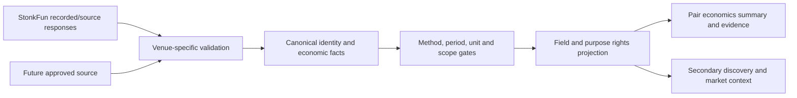

# Venue capabilities and adapter design

[Issue #78](PAIR_ECONOMICS_V1.md), design only. **StonkFun is currently the supported reward source.** Existing optional DexScreener market context is not a native Raydium/Meteora/Pump.fun rewards integration. No new client, endpoint, key, provider request, collector or dependency is introduced.

## Support flags: implementation is not availability or permission

Each feature needs a descriptor `{supported: boolean, implementation: 'existing_source'|'existing_gate'|'not_implemented', evidenceCeiling, scope, limitation, rightsDecisionRef}`. `supported=true` means code can attempt a bounded supported operation or apply an existing gate. It does **not** mean a source is currently healthy, that any particular pair passes, chain settlement is validated or financial publication is licensed. A separate per-request Fact, freshness/coverage result and rights projection determine output. `supported=false` means SCOUT does not implement it, not that the protocol lacks it.

| Feature | StonkFun existing source/gate | Pump.fun | Raydium | Meteora |
| --- | --- | --- | --- | --- |
| Quote registry / bounded exact-mint catalog | true, provider registry/catalog sample | false | false | false |
| Provider-reported market context | true, nullable USD snapshots, unknown market tick time | false | false | false |
| Verified reward-mode settings | true, official identity/settings only | false | false | false |
| Exact reported lifetime holder distributions | true, eligible v2 ledger + verified unit; not chain proof | false | false | false |
| Observed interval comparison gate | true, existing strict Pulse; availability conditional, no completed pilot implied | false | false | false |
| Creator-fee / trading-fee accounting | false | false | false | false |
| Validated LP incentives / emissions / buybacks | false | false | false | false |
| Chain-validated pool linkage / payout sequence | false | false | false | false |
| Synchronized historical pair-price series | false | false | false | false |
| Realized holder returns | false; outside this roadmap's implementation | false | false | false |
| Universal token/pool search or non-Solana runtime support | false | false | false | false |
| Canonical draft adapter implemented | false; existing source is the first future mapper input | false | false | false |

Publication flags are **not** inferred from this table. #75 historical financial output remains withheld and its retention/commercial rights unresolved. Stonk current public APIs remain unchanged by the design; this is not a legal certification of pre-existing publication. No unnamed feature is enabled by default.

## Native launch versus downstream markets

The integration label identifies where a source record came from. The executing protocol/program, launch origin and current trading market are separate facts. A token launched through one service may have several downstream pools with different quotes/fee rules. Do not copy the launch's creator or holder economics onto all pools, assign a DEX pool's LP fees to token holders, or count the same migrated activity in both launch and pool totals. Migration/configuration epochs require sourced links and actual boundaries; absent mapping yields distinct records with unknown relationship.

| Candidate | Read-only research question before implementation | Minimum evidence / unresolved decisions |
| --- | --- | --- |
| **StonkFun first** | Which exact identity and scope do registry, catalog and v2 rewards attest? Can an authoritative payout watermark or complete sequence support the existing period gates? | Existing dated receipts support mode/lifetime distinctions, not universal pool settlement. Preserve registry ambiguity, raw units, sample bias and rights withholding. Resolve source freshness and current collection/precision/period limitations before marketing interval economics |
| **Pump.fun candidate** | For an owner-selected launch/program version, what are the actual launch/curve/creator fee rules, accrual versus claim semantics and downstream market transitions? Is any holder distribution actually configured? | Official program/address/version and config provenance; exact recipient and fee/reward assets; proved migration linkage; defined event and finality semantics; bounded discovery/history access; rights, rate/cost terms. Never translate “creator fee” into holder rewards or assume all later pools share those rules |
| **Raydium candidate** | Which pool/program version is in scope, what trade-fee splits or position incentives are documented for it, and who is entitled under its actual position/config rules? How does a launch record link to that pool? | Verify pair orientation, program and pool identity, fee schedule/epochs, LP position versus creator/holder populations, event completeness, quote units, history depth and redistribution rights. Existing DexScreener labels or Stonk catalog pool identifiers alone cannot supply native verification |
| **Meteora candidate** | Which selected pool/program and fee/incentive configuration is relevant, how are recipient/position eligibility and any changing parameters evidenced, and what settlement history is available? | Verify configuration epochs, recipient class, actual fee assets, claim versus delivery, program-specific market structure, price orientation and completeness. Do not apply a constant fee-rate assumption or equate LP/position incentives with token-holder distributions |

These are research requirements, **not verified statements that every program offers these mechanisms**. No protocol-wide fee percentages, live API routes, quotas, current payout coverage or license terms were inspected/validated in this issue. Official starting points for the later spike: [Pump public documentation](https://github.com/pump-fun/pump-public-docs), [Raydium documentation](https://docs.raydium.io/raydium/), [Meteora documentation](https://docs.meteora.ag/). These links were not fetched for this design and establish no capability, availability, permission or equivalence. The spike must pin exact versions, URLs, received hashes and capture dates before relying on claims. No future endpoint is invented here.

## Adapter boundary



Responsibilities in the proposed boundary:

| Stage | Contract and fail-closed behavior |
| --- | --- |
| Capability registry | Versioned descriptors by integration, chain, program/version and feature. No generic `hasRewards` and no protocol-name wildcard. UI receives supported and available states separately; feature flags cannot manufacture data |
| Identity resolution | Accept structured chain + exact asset/pair/market selectors, not upstream URLs. Return candidates with identity type, pool/program/venue assurance, ambiguity and incomplete search scope. Never choose a duplicate ticker, chain or highest-liquidity pool silently |
| Evidence acquisition, later authorized phase only | Fixed approved GET/RPC read methods and origins, no redirect/SSRF path, byte/deadline/concurrency/request ceilings, shared admission/cooldown policy, sanitized errors, no wallet or write/claim/launch methods. Unknown source/permissions/costs fail closed. Do not broaden current Stonk budgets |
| Offline normalization, first implementation | `normalize(receipts, selector, policyVersion)` is pure: verify received-byte hashes, identity, units, clocks, config epochs, coverage and signed/raw precision; output draft facts or explicit failures. Input has no live credentials, implicit clock or current-data fallback. An `asOf` is explicitly trusted by the caller and cannot relabel historical captures as current |
| Current evaluation | Separate `evaluate(facts, trustedAsOf, methodVersion)` applies source-specific existing gates; outputs evidence claims, not profitable-token scores. Observed aggregate deltas and chain-reconstructed sequences remain different methods. Non-Solana finality/address support requires independent implementation and tests |
| Public projection | Independently intersect field/use-specific permissions and owner approval across all sources, then expose only allowed facts. Block restricted values in pages, APIs, OG, exports, errors and logs; source citations/hashes do not grant a license. Preserve #75's exact gate |
| Presentation | Economics primary; discovery sorts/filtering operate only on eligible scoped metadata. Clearly label alternate-market snapshots and supported venue. No fallback provider can inherit another provider's rights, finality or verified pool identity |

Proposed operation signatures, using the [draft vocabulary](PAIR_ECONOMICS_CONTRACT.md), are design boundaries rather than a callable client:

```text
describeCapabilities(chain, programVersion) -> FeatureDescriptors
resolveIdentities(structuredSelector, approvedBudget) -> BoundedCandidates | ReadFailure
readEvidence(exactBinding, requestedFeatures, approvedBudget) -> ReceiptSet | ReadFailure
normalize(recordedReceipts, exactSelector, validationPolicy) -> DraftFacts | ValidationFailure
evaluate(draftFacts, trustedAsOf, methodVersion) -> EligibleClaims | WithheldClaims
project(eligibleClaims, reviewedRights, purpose, trustedAsOf) -> PublicClaims
```

`ReadFailure` must distinguish unsupported, identity ambiguous, absent **within a stated scope**, capacity refusal, upstream rate limit, unavailable, malformed, stale and unknown outcome. It carries sanitized reason, original attempted scope and cooldown/deadline, never a fabricated zero/empty-complete set. Current routes may surface upstream 429 through structured 503; do not change that contract. Honor the actual Retry-After, do not retry on each keystroke, drop warnings on cache reuse, fetch past a declared ceiling, or treat per-instance admission as global protection. No automatic paid provider fallback.

Deduplicate at the correct grain: immutable receipt identity for source captures, chain + signature/transaction + transfer-leg index + asset + recipient scope for validated transfers. Two providers reporting the same payout are corroboration, not two payouts. Distinguish different token-wide aggregates from disjoint pools; do not sum overlaps. Retention, unknown cutoffs and cursor completeness must survive restarts, exports and later schema versions.

## First safe adoption and approvals

First proposed engineering step is an **offline StonkFun mapper** over already retained reviewed evidence, leaving public output and existing readers untouched. Unknown base decimals, protocol linkage, entitlement and fees stay unknown. Golden replay tests must preserve #75's four dated IDs/units/capture dates and withheld financial output, and preserve Pulse's independent reasons rather than making every adapter appear equivalent.

Only after a provider/program-specific read-only spike may the owner choose **one** next integration. Selection criteria: source/rights clarity, verifiable recipient/fee semantics, exact identity and history availability, bounded operational load and relevance to the product promise—not token attention or speculative reward volume. There is no automatic next-venue winner and no authority to use a paid endpoint. Existing infrastructure budget targets do not authorize a venue data subscription. Stage C2/collection approval remains a separate workstream; no adapter may bypass it by adding an ad hoc collector or Cloudflare trigger.
