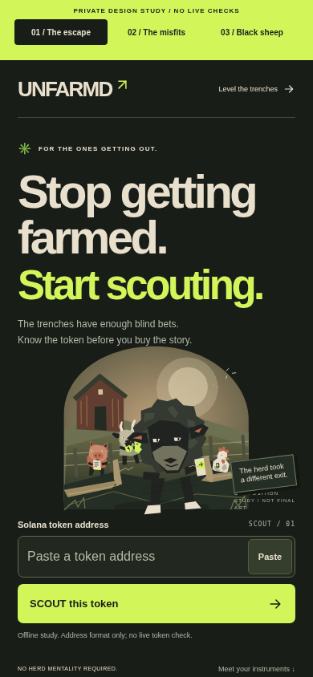
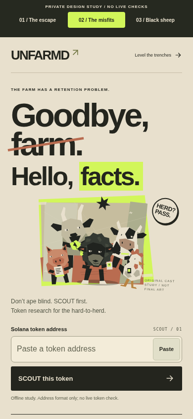
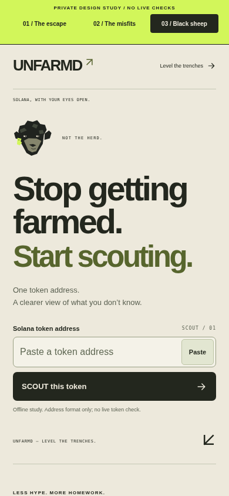

# UNFARMD / Level the trenches

Three browser-rendered, review-only identities for [#132](https://github.com/fuzzysniper/scout-stonk-intel/issues/132). Base `ac1d898578a3a7e17ec30a272674e38316d16397` includes merged SCOUT V3 #129 and incident fix #131. The public homepage remains SCOUT. No production route, backend, dependency, infrastructure or activation changed.

Audit: `app/page.tsx` owns the current exact-mint homepage; `app/consumer/home.tsx` preserves deliberate paste/submit, history and separate historical examples; `trader.tsx`/`onchain-model.ts` preserve accepted-source concerns, precision, freshness and unknowns. Existing V3 screenshot/QA documentation remains unchanged. Rather than relabel those live routes or fork their API clients, this branch keeps the brand study in `experiments/unfarmd-brand/` and imports only the existing pure exact-mint guard. The merged #131 native PostgreSQL TLS fix and all incident/canary files are outside the diff.

**The trenchers are farm animals escaping the farm.** The farm represents information asymmetry, shill funnels and exit-liquidity traps. It is a metaphor, not an allegation about an identifiable person. The animals are curious and capable: they read the fine print, find the exit and take the scanner with them.

## The three directions

| Direction | First impression | Visual language | Tradeoff |
| --- | --- | --- | --- |
| **01 / The escape** | “Stop getting farmed. Start scouting.” A charcoal sheep steps through the fence; the crew follows. | Cinematic arch, warm pasture light, charcoal/bone, restrained acid-lime instrument. Product form stays sober. | Strongest expression of the founder narrative. Final art must retain a legible small silhouette and avoid becoming a film poster that hides the input. |
| **02 / The misfits** | “Goodbye, farm. Hello, facts.” A goat-led, mixed animal crew owns the frame. | Bone paper, clay, offset-style tilted ensemble, a crossed-out “farm,” dry editorial humor. | Strongest community/campaign potential; busier than the other two. Tests an alternative hero rather than declaring the sheep final. |
| **03 / Black sheep** | A small, skeptical sheep mark. One address. Less instinct, more evidence. | Open paper field, large precise typography, olive/charcoal, compact instrument and almost no illustration. | Clearest utility and easiest identity to scale; the escape narrative needs supporting copy rather than a cinematic image. |

**Recommendation for founder selection:** take **01 / The escape** into commissioned-art exploration first. It communicates the new story without an explanation and leaves the instrument recognizable. Keep **02** as a serious alternative for character-led community work, and compare **03** as the clarity/control case. This is a recommendation, not a chosen mascot, selected public brand or permission to ship a hybrid. The owner chooses the direction and supplies/reviews final assets before public work.

## Actual browser comparisons

Viewport captures are genuine Chromium renders, not image composites or generated screenshots. Full-page captures expose all limitations rather than cropping them out. 320/390 are touch-emulated mobile viewports, not physical iPhones.

| View | 320 × 740 | 390 × 844 | 1280 × 900 |
| --- | --- | --- | --- |
| Current actual Next production home, idle | [before](screenshots/before-current-home-320.png) | [before](screenshots/before-current-home-390.png) | [before](screenshots/before-current-home-1280.png) |
| 01 / The escape | [viewport](screenshots/after-escape-320.png) | [viewport](screenshots/after-escape-390.png) | [viewport](screenshots/after-escape-1280.png) |
| 02 / The misfits | [viewport](screenshots/after-squad-320.png) | [viewport](screenshots/after-squad-390.png) | [viewport](screenshots/after-squad-1280.png) |
| 03 / Black sheep | [viewport](screenshots/after-quiet-320.png) | [viewport](screenshots/after-quiet-390.png) | [viewport](screenshots/after-quiet-1280.png) |
| 01 / Full page | [full](screenshots/after-escape-full-320.png) | [full](screenshots/after-escape-full-390.png) | [full](screenshots/after-escape-full-1280.png) |
| 02 / Full page | [full](screenshots/after-squad-full-320.png) | [full](screenshots/after-squad-full-390.png) | [full](screenshots/after-squad-full-1280.png) |
| 03 / Full page | [full](screenshots/after-quiet-full-320.png) | [full](screenshots/after-quiet-full-390.png) | [full](screenshots/after-quiet-full-1280.png) |
| Address-only interaction, no token facts | [01](screenshots/after-escape-address-only-320.png) | [02](screenshots/after-squad-address-only-390.png) | [03](screenshots/after-quiet-address-only-1280.png) |

## Product and copy architecture

**UNFARMD** is the proposed consumer brand. **SCOUT** is the token-research action/instrument, not a competing brand. **PULSE** is future qualified research, explicitly inactive. **RECEIPTS** names the evidence layer: a source claim and its boundaries, not guaranteed truth. Mission: **“Level the trenches.”** Core line: **“Stop getting farmed. Start scouting.”** Supporting voice: **“Don’t ape blind. SCOUT first.”** Humor aims at the information problem, not named people, token holders or victims.

All three share the same deliberate exact Solana address input, 16px type, native/type fallback, obvious SCOUT submit and visible offline boundary. The valid-path result says **“Address format checked. Token facts not checked.”** It shows the original address and unavailable source states. No RPC, provider, database or API call is possible through the prototype’s code. No wallet, sign-in, chain picker, fictional token, fabricated chart/statistic, rank, score, price, return, “live” badge or PULSE signal is shown.

The production MintFactsV1/client boundary is not forked or mounted. An eventual selected design must continue using the existing same-origin clients and strict acceptance gates. Exact supply, authority interpretation, Token-2022 limits, original checked clocks, stale/error/disabled distinctions, provenance, quote identities and publication restrictions remain requirements, not achievements claimed by this design study. The real three StonkFun examples remain dated **14 October 2026**, stale and separate; their financial figures and rights limitations are unchanged.

## Original character direction

See the [exportable original vector sheet](../../experiments/unfarmd-brand/art/character-sheet.svg) and [Midjourney prompt sheets](MIDJOURNEY.md). Geometric SVGs are authored composition placeholders. No copied meme character, stock art, tactical hood, third-party logo or external image service is used. These studies are not represented as final licensed assets, trademark clearance or proof of exclusive rights to AI output.

| Character | Agency / humor | Repeatable visual cue |
| --- | --- | --- |
| Black sheep / the skeptic | “Not the herd.” Checks the claim before stepping through. | Charcoal angular wool, broken lime tag, narrowed cream eyes; small scanner in narrative scenes. |
| Goat / route-finder | Finds the gap, not the hype. Alternative lead in direction 02. | Long backward horns, asymmetric beard, folded lime route card. |
| Pig / fine-print reader | The footnote has a footnote. | Clay skin, broad angled snout, bone paper with lime tab. |
| Cow / steady hand | Hard to rush. Harder to fool. | Bone/charcoal patches, calm level eyes, lime seam. |
| Chicken / first to notice | Cautious is not cowardly. | Angular clay comb, watchful profile, tiny lime instrument. |

No weapons, smoking, sexualized animals, adult-victim caricatures or named farm villain. Keep silhouettes confident rather than cuddly, muscular rather than militarized, funny rather than manic. Final expression/shape needs original artist development; the current SVG cast is intentionally a geometry study, not polished illustration masquerading as one.

## Critical review and founder gates

- The narrative is memorable; “farmed” still assumes crypto-native vocabulary. Five-second testing must verify users understand token research rather than a game, animal coin or escape simulator.
- Direction 01 has the strongest story but carries illustration weight. The initial browser review caught a four-line mobile wrap; the final layout keeps the CTA and offline warning inside all three tested viewports. Final art must not reverse that.
- Direction 02 is funnier, more social and less restrained. It is the most likely to feel like merchandise before a useful product. The goat-led ensemble deliberately tests whether a sole sheep mascot is needed.
- Direction 03 is the cleanest instrument wrapper. It risks looking like an editorial identity with too little world-building; a mascot can’t replace clear source status.
- PULSE must stay visibly future until source, coverage, rights and activation approvals exist. A consumer brand change never authorizes a backend capability.
- SVG placeholder authorship does not settle final artwork, trademark, domain, commercial rights or legal review. UNFARMD, SCOUT, PULSE and RECEIPTS naming clearance remains open. No domain search, registration or brand launch was performed.

No human comprehension sessions or physical Safari tests were conducted. See [QA and founder acceptance](QA.md) for the uncoached comparison script and device checklist. Separate approval is required to choose the identity, acquire final art, clear naming/rights and implement any public rebrand.

## Rollback

No public rollout occurred. Remove `experiments/unfarmd-brand/` and `docs/unfarmd-brand/`, or close the PR; the existing app stays unchanged. There are no migrations, API changes, settings, credentials, schedules or data changes to reverse. If this review-only branch is later merged by a human, reverting its merge removes only the isolated study. Do not repurpose rollback to retry the incident canary or activate a provider.
