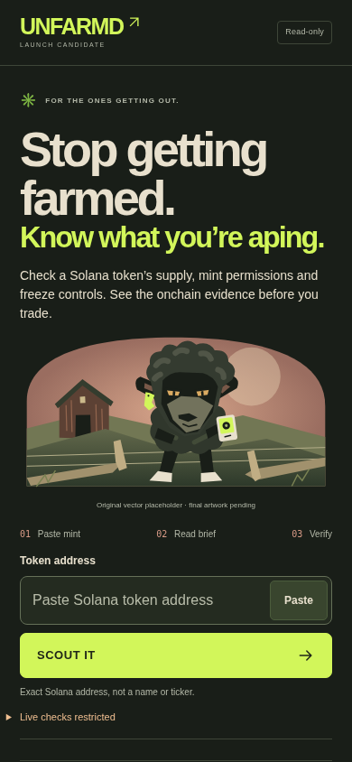

# UNFARMD V1 — the working consumer application

Issue [#134](https://github.com/fuzzysniper/scout-stonk-intel/issues/134). Based directly on latest main **`ac1d898578a3a7e17ec30a272674e38316d16397`**, including the merged incident fix #131. The design takes inspiration from selected direction 01 in draft #133; that branch was **not merged, cherry-picked or used as a replacement application**.

This changes the actual Next.js `/` consumer: **paste an exact mint → deliberate SCOUT IT → the existing SCOUT Brief, concerns, onchain renderer, market evidence and dated StonkFun layer**. It is a working implementation prepared for review, not the offline address-format-only prototype. No merge, manual deployment, provider activation or public launch is authorized by this branch.

The subsequent [SCOUT IT interaction audit and before/after evidence](polish/README.md) documents the narrowly verified focus fixes without changing the approved homepage copy, design or artwork.

Current launch decision: [combined #136 backend / SCOUT IT release acceptance, preview and rollback](release/README.md). This supersedes earlier automatic-acquisition assumptions; approved visual galleries remain historical evidence.

Latest asset handoff: [founder-selected artwork, responsive captures and rights-pending provenance](artwork/README.md). This supersedes the original-placeholder descriptions and screenshots below; those are retained as dated implementation history.

## What changed

- **UNFARMD** is the homepage master brand. The final founder headline is “Stop getting farmed.” / “Know what you’re aping.”, with “Check a Solana token’s supply, mint permissions and freeze controls. See the onchain evidence before you trade.” The input says “Paste Solana token address”; the action remains **SCOUT IT**. “Stop getting farmed. Start scouting.” remains the broader campaign tagline on the social preview; “Level the trenches.” remains the mission. The black sheep leads: skeptical amber eyes, thick charcoal wool, broken tag, compact optical scanner. Charcoal/bone surfaces, acid-lime instrument cues and a dusty-coral dusk replace the V3 blue-black palette.
- The original illustration has **separate mobile and desktop compositions**. One sheep leads the first viewport; supporting animals live in an optional below-fold lore disclosure. The illustration disappears on results so evidence and concerns keep their space.
- The real controlled form, original `lookup`, URL/history/share behavior, paste race cancellation, manual retry/cooldown and `TokenResearch` wiring remain. There is no new resolver, request client, format-only result, synthetic URL flag or backend contract.
- **PULSE** links to existing CARDS pair research, labeled research-only with financial figures withheld. **RECEIPTS** links to the dated source index. Neither link claims current prices, signals, complete coverage, holder/LP verification or returns. Link prefetch is disabled.
- Homepage metadata, a local avatar icon and the genuine 1200×630 PNG adopt the candidate identity. **Canonical/OG URLs remain on `https://scout.storkcoin.xyz`; no domain, routing or Vercel configuration changes.** Root layout and legacy research chrome stay unchanged.
- “LAUNCH CANDIDATE”, the visible original-placeholder caption and footer distinguish this implementation candidate from cleared final artwork/name or an authorized public launch.

## Actual production-browser comparison

Every page capture below is a genuine Chromium render of **Next.js production**, not a Vite mockup or an edited image. The baseline was built and captured before editing the current main consumer. Mobile widths are touch emulation, not physical iPhone results. “Offline replay” screenshots have a prominent test-only warning and contain invented **onchain test values**, never actual Helius observations or market quotes.

| State | 320 × 740 | 390 × 844 | 1280 × 900 |
| --- | --- | --- | --- |
| Before · current SCOUT V3 | [image](screenshots/before-idle-320.png) | [image](screenshots/before-idle-390.png) | [image](screenshots/before-idle-1280.png) |
| After · UNFARMD landing | [image](screenshots/after-idle-320.png) | [image](screenshots/after-idle-390.png) | [image](screenshots/after-idle-1280.png) |
| After · full landing | [image](screenshots/after-idle-full-320.png) | [image](screenshots/after-idle-full-390.png) | [image](screenshots/after-idle-full-1280.png) |
| Before · actual local GET denied | [image](screenshots/before-actual-denied-320.png) | [image](screenshots/before-actual-denied-390.png) | [image](screenshots/before-actual-denied-1280.png) |
| After · actual local GET denied | [image](screenshots/after-actual-denied-320.png) | [image](screenshots/after-actual-denied-390.png) | [image](screenshots/after-actual-denied-1280.png) |
| Before · stale StonkFun example | [image](screenshots/before-historical-320.png) | [image](screenshots/before-historical-390.png) | [image](screenshots/before-historical-1280.png) |
| After · stale StonkFun example | [image](screenshots/after-historical-320.png) | [image](screenshots/after-historical-390.png) | [image](screenshots/after-historical-1280.png) |
| After · dated source receipts | [image](screenshots/after-historical-receipts-320.png) | [image](screenshots/after-historical-receipts-390.png) | [image](screenshots/after-historical-receipts-1280.png) |
| Before · SYNTHETIC offline replay | [image](screenshots/before-offline-replay-320.png) | [image](screenshots/before-offline-replay-390.png) | [image](screenshots/before-offline-replay-1280.png) |
| After · SYNTHETIC offline replay | [image](screenshots/after-offline-replay-320.png) | [image](screenshots/after-offline-replay-390.png) | [image](screenshots/after-offline-replay-1280.png) |
| After · SYNTHETIC onchain receipts | [image](screenshots/after-offline-receipts-320.png) | [image](screenshots/after-offline-receipts-390.png) | [image](screenshots/after-offline-receipts-1280.png) |
| After · offline loading | [image](screenshots/after-offline-loading-320.png) | [image](screenshots/after-offline-loading-390.png) | [image](screenshots/after-offline-loading-1280.png) |
| After · offline 429 / manual cooldown | [image](screenshots/after-offline-rate-limited-320.png) | [image](screenshots/after-offline-rate-limited-390.png) | [image](screenshots/after-offline-rate-limited-1280.png) |

The [actual social preview PNG](screenshots/after-social-preview.png), [QA/results](QA.md), [asset replacement instructions](ARTWORK.md) and [physical Safari checklist](IPHONE.md) accompany these captures.

## What is real, and what remains unavailable

The consumer uses the unchanged production same-origin GET clients. In the real local production test, `/api/mint-facts` returns **403 `access_denied`**, no accepted facts, no checked source slot/time and no token-specific concerns. This is an actual admission denial on localhost; it is not proof the token is invalid or that a production canary succeeded. Ordinary production GET acquisition remains disabled by the existing server policy. This UI never sends the separately controlled canary POST or retries the original one-shot budget.

When a separately approved backend can return an accepted MintFactsV1, this UI already renders exact decimal supply, original mint identity, Token Program/Token-2022, standard authority interpretation, extension-review limits, finalized context slot, original checked time and provenance. That path is exercised here with explicitly labeled offline interception through the real validator. It does not establish an authentic observation, independent replay, project legitimacy or complete risk coverage.

Holder concentration, insider allocation, LP control, sellability and holder returns remain unknown. Markets keep their independent source state, precise pool/base/quote identity and retrieval-clock limitation; price, liquidity, volume, movement and capitalization remain withheld. No financial fixture values or invented price charts appear in the new screenshots.

The three exact StonkFun examples remain separate **14 October 2026 stale captures**, with original source URLs, units, hashes, mechanism semantics, unknown holder payments and explicit no-underlying-stock/gold/SpaceX-ownership explanations. Their source/publication rights remain unverified, and financial figures remain withheld. Brand selection and final-art rights cannot authorize publication of source-derived financial data.

## Changed production files and isolation

`app/consumer/home.tsx` (presentation/copy, original control flow retained), `app/consumer/model.ts` (metadata copy/icon only), `app/consumer/unfarmd.css`, the small `app/consumer/brand/` presentation/art seam, `public/consumer/unfarmd/` original SVGs, the homepage CSS import in `app/page.tsx`, and homepage-only `app/opengraph-image.tsx`. Other changes are scoped consumer tests/harness and this documentation.

**Unchanged:** `trader.tsx`, `trader-model.ts`, `onchain.tsx`, all onchain clients/validators/contracts, every `app/api/**` route, `lib/onchain-mint/**`, `lib/trader-pulse/**`, original evidence/data, root layout/legacy terminal/research routes, runtime admission budgets, Helius/Neon, PR #118/#131 files, credentials, workflows, collectors/archive, Cloudflare and Vercel/domain configuration. No new dependency, provider, paid asset, remote font, wallet, transaction or stored watchlist.

## Launch gates and rollback

The founder selected the direction, not final commercial art, trademark/domain clearance, source readiness or a deployment. Those require separate owner review/authorization. The application keeps the existing domain. Final assets must be supplied as originals and pass [ARTWORK.md](ARTWORK.md). Physical Safari/VoiceOver acceptance remains pending; Chromium and axe are evidence for their tested scope only. An infrastructure incident is not resolved by changing the homepage.

No public rollout was performed. The owner may close the draft or, after a future human merge, revert this PR’s merge through the normal reviewed release path. This restores V3 presentation and metadata; no dataset, route contract, migration, provider, secret or schedule needs reversing. Never use rebranding or rollback to reset/reuse the canary budget or activate a source.
