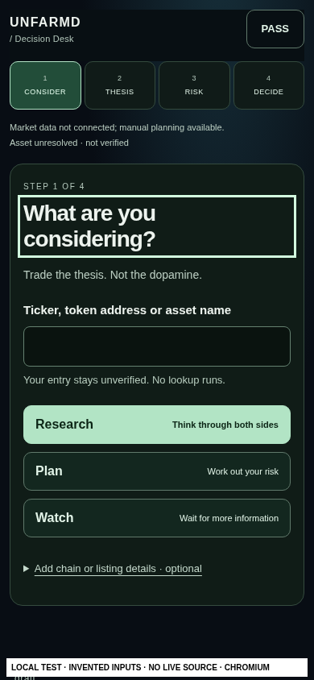

# #209 — one question at a time

Dependent draft from #200 `ae0d1918679a40aeca69da0bea3dade0a0b5e85e`. Founder rejected the previous UI after personally failing unaided completion. Automated browser success did not establish usable first use. This revision replaces the competing entry cards, clickable stage/risk tabs and sticky PASS header with one input and **Think it through**, then one question at a time.

## Founder acceptance — no walkthrough

Open the protected review `/desk` on iPhone. Use only the app. Can you see the first action without help? Explore an invented TEST idea, wait for evidence with WATCH, then start again and PASS with a reason. Say where you hesitated. Nothing is saved or executed; refresh clears the draft. The goal is a decision in under60 seconds, not a promised timing or complete diligence.

Only then attempt an untimed hypothetical PLAN. All values invented: TEST unresolved; demand could improve/fail to improve; liquidity and execution unknown; shorter-term holding, one week; unleveraged long/USD; entry100/exit90; explicitly tap **Use current time**, select **1 hour**; exit may fail; reference capital10000/cash4000/exposure1000; loss budget100/allocation20%; owner-proposed5 units; fees0.10% each, slippage0.20% each, fixed round trip1. Write a reason and read both acknowledgements. Expect5 / planned loss53.86 / entry cash502.51. Actual loss may exceed plan. Unknown source and asset, no market fact, guaranteed exit, advice or execution.

Before acceptance, test invalid exit100, expired time, missing answers and excessive quantity. They must refuse PLAN without blocking WATCH/PASS. Test VoiceOver, Safari picker, local-time confirmation, keyboard visibility, large text, Back, clear and reload. Any confusion = HOLD; do not call automated QA physical acceptance.

## Literal short-path button counts

- PASS without an asset: Think it through → Pass on this idea → Keep this PASS for now; **3 button actions**, plus a written reason.
- WATCH with a named idea and incomplete research: Think it through → Decide for now instead → Watch for now → Keep this WATCH for now; **4 button actions**, plus idea/reason (partial research optional).
- Guided research: three separate questions before the decision. Blank research remains incomplete; only the unchanged PLAN adapter can approve a full manual PLAN.

No action on the first screen silently selects a financial instrument, currency, price, capital, quantity, timestamp, validity or cost. “Use current time” captures device NOW only on tap, retaining UTC milliseconds with local-time confirmation; it is not a price refresh or trusted source clock. Durations map exactly15m=900/1h=3600/1day=86400 seconds, with optional explicit custom seconds. Review/save recheck real time. Costs can be explicitly unestimated with acknowledgement, never silently zeroed.

## Before / after — actual local Chromium, not physical Safari

|Before: competing cards + navigation|After: one input + one action|
|---|---|
|||

Baseline images captured during #208 against the exact same parent UI. New images from optimized local app. Each labeled LOCAL TEST / invented inputs / sources OFF. 320/1280 counterparts, WATCH, full PLAN, time correction and200% CSS zoom are alongside them. Screen labels are QA-only DOM annotations removed after capture. No sticky controls remain to cover tabs or inputs.

## Exact scope / blocking integration review

Only existing runtime path changed: `app/desk/journey/desk-journey.tsx`, now a client re-export of the additive guided UI. All other parent files, original A/B risk/evidence/adapters, percentages/math, source/OFF/auth/STOP, collector history, scope guards/manifests, historical tests and release lifecycle remain byte/mode identical. New explicit `tests/desk-guided209/scope.test.mjs` checks this independently; it does not replace or authorize changes to the original guards.

**Integration remains blocked by the unchanged frozen-source guard.** Original wrapper SHA-256 `cf6245f6ebefb97beee9ba1fc5e532077bb3fb010cab085f99680a6f32a42cf5`; proposed wrapper `608add48a56c7761b8afef336ec65cb79a705097cfcc437a465aecf8991d3062`. New app files: guided-desk.tsx, guided-field.tsx, guided.module.css, sequence.ts. New dedicated tests, screenshots, this document and read-only test workflow are enumerated by the new scope test. No original hash, source manifest, exception, guard or workflow has been edited to make this green.

Required independent review: exact UI/test/doc patch and all resulting hashes; physical first use; then a separately reviewed, finite hash-pinned composition/lifecycle update for only these paths. Existing current-UI browser tests describe the retired DOM and will also reject this redesign; preserve/run them against the original exact tree. Do not skip safety tests or label expected rejection green. Production remains HOLD; this draft is not an approved successor release.

## Verification / rollback

`tests/desk-guided209/run.sh` executes unchanged C113 adapter cases +5 new sequence tests +3 independent scope assertions. Dedicated Playwright exercises320/390/1280, actual A/B math, denials, explicit time/durations, one-action landing, short WATCH/PASS, keyboard/focus, CSS200% zoom, reduced motion, short viewport, axe, no network/storage/cookies and clearing. Full root/native security runs separately; report unavailable tooling or actual failures explicitly.

Rollback: abandon this unmerged dependent draft. No main/integration/data/deployment change to undo. Any later integrated rollback must be reviewed separately and preserve latest collector data and all OFF/auth/STOP gates.

## Recorded local verification (2026-10-28)

- Full root: **1350 Node +107 Python**, no failures/skips, including real disposable PostgreSQL/TLS and auth/STOP security regressions. The executor originally lacked PostgreSQL; downloaded local test-only17.10 binaries and16.15 psql outside the repository. No package manifest, SQL, hosted database, auth or source change. Initial missing-tool/stale-origin attempts were corrected before the successful full run.
- Unchanged C/adapters113 +new sequence5 = **118**, new exact-base preservation/scope3; current A47, B replay146, typed linkage24. Original C196/B198 full standalone scope suites pass in their unchanged exact source trees. Historical191 focused suites pass.
- **27 distinct new browser cases** across320/390/1280: initial24 successful flows plus3 validity checks after adding the duration error association. axe WCAG2A/AA,2.1AA,2.2AA, keyboard/focus,200% CSS zoom/reduced motion, shortened viewport and no API/external/storage/cookie/error activity asserted. Browser dates are explicit QA-only invented fixtures; not source facts or production defaults. Before/after captures are real rendered UI, not mockups.
- Historical191 browser27; unchanged private homepage39; existing native HTTPS/PG parent auth/STOP mobile5 passed. Fresh types, lint (zero warnings), optimized build, default-OFF live/continuous endpoint checks and archive check pass.
- The original aggregate scope gate deliberately fails on the changed C UI hash (2/4 cases refused); original C/B whole-aggregate guards and DOM-specific retired-UI browser tests also block the inherited integration workflow. **Not green aggregate CI, not release-ready or founder-accepted.** No guard/manifest/workflow altered to hide this. New dedicated read-only CI exercises the successor UI independently and retains original source-history suites.

Physical Safari/native keyboard/VoiceOver/large text and genuine unaided task completion remain pending. CSS zoom and shortened Chromium viewport do not prove native keyboard or VoiceOver behavior. No extra founder screenshots requested as a substitute for fixing the product.
