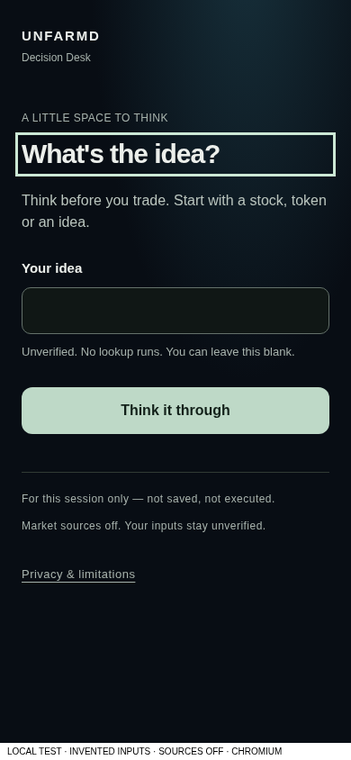

# Alpha Lens — source-OFF review

Based on freshly fetched main `5c6e36fef0fc15acb07c954566a3975cb77fc102`. Separate `/lens`; no V3 branch, source pin, API or security gate modified. Only existing file change is the exact `/lens` chrome exemption; every other route retains its navigation/footer behavior.

One page: paste a Solana CA → View facts → read the unavailable evidence → write MY THESIS. There is no wizard, risk calculator, saved history, tracking, account or application storage. Sources are explicitly OFF. Address validation recognizes format only, not token existence or ownership. All shipped cards are grey, with provider/observation-time/reason disclosures. Green/yellow/red are renderer vocabulary exercised only with labeled synthetic test inputs, not runtime examples or admission logic.

A#212 and B#213 contracts were reviewed. Future integration requires reviewed exact-mint identity, admitted provenance/freshness, independent pool context and provider rights; this UI does not substitute its own classifier or activate existing token APIs. Green means a narrow check passed, amber caution, red material risk, grey unavailable. Words and symbols accompany color. No universal score or safety/buy/sell claim.

## Uncoached owner check

Open protected review `/lens` on iPhone with no walkthrough. Can you find the only first action, paste a CA, identify why a grey fact is unavailable, open its source explanation and write a thesis? Can you find optional counter-evidence, edit the note, and understand NOT SAVED? Native VoiceOver, keyboard and physical unaided acceptance remain pending. Without provider GO there can be no authentic red/green live observation. Do not invent one to complete this check.

Refresh/close clears notes; edits replace the unsaved draft. No revision receipt or encrypted/user-scoped journal exists. Durable history needs separate access/security/retention approval. Browser restoration is not secure erasure on a shared device.

## Before / after

Before is the founder-rejected #210 draft, not a change to main. After is the real source-OFF Lens. Both local Chromium; labeled test content, no live facts.

|Before: guided questions (#210)|After: one-page Lens|
|---|---|
|||

320/390/1280 after captures are in the same directory. These show grey runtime facts, never fabricated colored live records.

## Verification and blockers

Nine browser scenario/width combinations passed (six first-run, three corrected strict-selector negatives), axe A/AA, keyboard/focus, 200% CSS zoom, reduced motion and short viewport. Each asserts zero external/API requests, cookies, Storage/IndexedDB access and page errors. Two security/scope tests plus four-color SSR/provenance/escaping checks pass. Types, lint and optimized build pass. No claim full root CI or native Safari acceptance was completed locally for this change.

Reproduce: `bash tests/lens/run.sh`; guarded optimized build, then `NODE_OPTIONS=--import=$PWD/tests/security114/local-only.mjs node experiments/consumer-mvp/web/node_modules/@playwright/test/cli.js test -c tests/lens/playwright.config.mjs`.

Blockers: A/B contract integration, provider/rights approval, authentic observation acquisition, durable journal/privacy design and physical phone acceptance. No provider activation, credentials, SQL, merge or deployment authorized. Rollback: close this unmerged draft; after any separately approved integration, revert only its scoped page/chrome delta while preserving collector data and existing controls.
