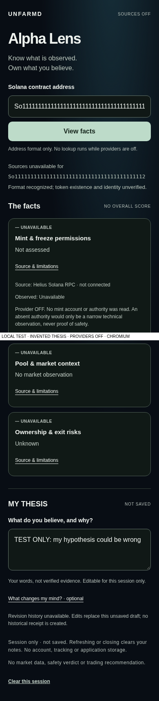
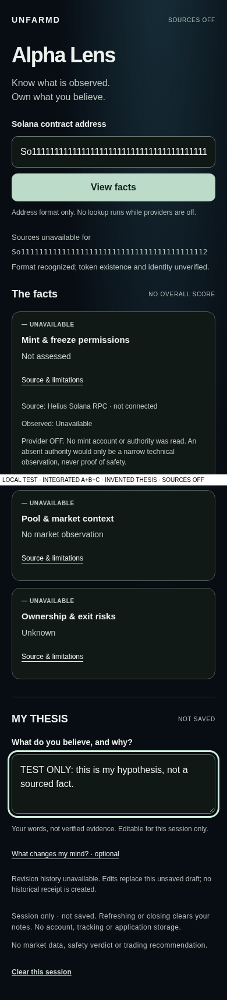

# Alpha Lens V4 source-OFF assembly — Issue #218

Review-only integration, not a source/storage or production release.
Base: `5c6e36fef0fc15acb07c954566a3975cb77fc102`.

|Source|Original exact head|Original paths|
|---|---|---|
|C #215|`ec527f8b4e3fb7f0c0df7b77c459ec6502267100`|15|
|A #216|`d6af31935f6202a3c8ee243735fc86d13f601a58`|9|
|B #217|`6ed24c97146a39599ad0855a809735f08c83f2b8`|19|

All source commits are ancestors through ordinary two-parent local integration
merges. No individual source PR, main, V3 #200/#210 or data commit was rewritten,
merged to production, rebased, squashed or force-pushed. Only original existing
paths are C's exact /lens chrome exception and A's single root-test hook.
Every original blob/mode/SHA-256 is independently rederived in source-manifest.
No source directory, data wildcard or guard-disable environment flag is admitted.

## Actual integration

The client source-off model uses A's real unavailable projection and B's pure
unavailable-card contract, then C's unchanged card presentation. It takes no
enable option, URL, response, key or captured example. Source OFF is immutable;
all three visible groups remain grey/no observation. Exact address validation
rejects whitespace/ticker/Unicode aliases without attempting a lookup. The page
stays one CA field, one View facts action, factual unknowns and unsaved MY THESIS.
No API/server action, automatic provider call, saved history or export is added.

A separate **server-only offline** captured bridge runs actual A and B against
the same copied original RPC receipt; market bytes use B's existing DEX decoder.
No serialized A object is cast into admission. Exact network/mint/host/request
semantics, raw hash, source clocks, finalized slot and capture-kind agreement
are checked; current evaluation expiry and cross-source skew are enforced. Any
missing/invalid/stale input returns grey/withheld facts, never a sample fallback.
Unsupported Token-2022 interpretations stay grey. Market values remain scoped
to a selected returned base pool, never token-wide liquidity/circulation/issuer
legitimacy. Fetch clocks do not become trade/block times. All observation times
remain unknown; offline capture origin/authentication stays explicitly unverified.
Synthetic fixtures support all four colors/per-check states, never runtime facts.

Thesis editing is current-session memory only. It does not append a B journal,
make a saved receipt, encrypt, export or persist anything. B's separately tested
append/replay/private-privacy schema remains available offline, with original
timestamps and request-only deletion semantics. Physical privacy/recovery and
durable access/storage remain separate owner decisions.

## Four finite source exceptions

|Original source file|Reviewed change|
|---|---|
|C app/lens/view.tsx|Use actual A/B source-off model; strict exact CA; no source input|
|C tests/lens/security.test.mjs|Replace incompatible standalone scope comparison with full pinned aggregate assertion; retain exact chrome and no-I/O tests|
|B lib/unfarmd-intelligence/source-off.ts|Extract unchanged grey-card semantics into client-safe pure helper; admission remains server-only|
|B tests/unfarmd-intelligence/scope.test.mjs|Replace19-files-only comparison with full source/patch/66-path assertion; retain original cases and hard-OFF/CI checks|

Original C scope genuinely rejected B's workflow; original B scope rejected C
files. Confirmed TAP failures are retained locally. The replacement rederives43
original files and exact modes/hashes, pins39 unchanged inputs and all four
complete before/after patch hashes, and allows exactly23 integration additions.
No test is deleted/skipped. Original A70/B88/C security+SSR suites run unchanged
in their exact detached source trees as well as current combined guards/adapters.
Mutated source, API, gate, runner, audit data and unknown paths fail closed.

All preexisting backend/API/consumer/homepage/auth/STOP/SQL/collector/source
permissions/Cloudflare/cron/credentials/dependencies/V3 code remain byte-identical.
The three reviewed-main data files and Git modes stay exact. This is a **review
snapshot**, not approval for future main/data drift: a newer base/code/data or
lost ancestry requires fresh review and exact-base rehearsal, not an automatic
new allowance or counter reset. Normal two-parent merge only for any later release.

## Reproduce and review

Full root regression: `NODE_OPTIONS=--import=$PWD/tests/security114/local-only.mjs npm test`.
New integration and C: `bash tests/v4-integration/run.sh`.
Source originals: `bash tests/v4-integration/source-history.sh`.
After guarded optimized build: `bash tests/v4-integration/snapshots.sh`.
Actual local PG/TLS/auth/STOP uses disposable SYNTHETIC fixtures, never hosted SQL.
Node source code network guard denies nonlocal requests. Browser tests enforce
zero external/API requests, cookies and Storage/IndexedDB access. CI is read-only,
has no dispatch/schedule/secrets/provider or deploy command; the old root runner
is exactly A's reviewed source and discovers B/integration Python wrappers.

Before is a genuine local replay of exact C215 source-OFF /lens, not V3/the old
guided desk. After is the actual optimized combined UI. Layout is intentionally
preserved; new integration is functional/contractual, not a cosmetic redesign.
All images show LOCAL TEST/invented owner notes/providers OFF. Raw after images
live under tests/v4-integration/screenshots; original source PNGs are restored
after known QA generation. No image editing or fabricated provider result.

|Before C source|After combined|
|---|---|
|||

## Literal owner acceptance task — pending physical iPhone

On the **verified protected unique preview** /lens, without walkthrough: paste a
public exact Solana CA, press View facts, say what is unknown and whether any
provider was contacted, open a source disclosure, write a short hypothesis and
optional counter-evidence. Can you find NOT SAVED, revise the note without a
wizard, clear the session and understand there is no historical receipt? The
browser executes this exact task with invented text, but is not an unaided human
study. Physical iPhone/VoiceOver, keyboard and first-use comprehension remain
founder-dependent. Green/red real facts cannot be part of this OFF acceptance.

Critical visual review: layout is deliberately C's original calm single page,
not a new visual design. The three unknown groups and expanded evidence push
MY THESIS below the first viewport at320/390; a short scroll is required. The
single mint action and NOT SAVED label are clear, but this is not proof that all
information fits one screen or that a real iPhone keyboard will behave perfectly.
No live alpha is available while sources are OFF. Test footer labels and invented
notes distinguish actual before/after captures; there is no image postprocessing.

## Hosted preview and owner gates

Only the existing automatic Git-linked Vercel PREVIEW may build this draft. No
manual deployment, domain/alias/protection/env change, login, key pull or share
link is authorized. Confirm exact deployment SHA/ID/project and effective private
Authentication before saying private-preview verified. Connected project lookup
returned404 and this executor has no Vercel CLI; metadata/status alone cannot
prove protection or hosted UI. If unavailable, report HOLD with the unique link
and owner read-back steps; do not invent access or weaken protection.

Before any source or durable storage: review provider rights/current clocks,
authentic bounded acquisition and production admission/quota/retention; separately
review user auth/isolation, encryption/CAS/backup/PITR/recovery/deletion/costs.
Existing source/legacy canary/lookup histories and unknown prior usage stay intact.
LOOKUP/preflight remain disabled/null; do not claim all old constants are false.
No release/source/storage GO follows tests or preview status.

Rollback: close this unmerged draft. After any separately authorized release,
prepare a reviewed code-only revert on then-current main, preserving all current
collector data/modes/counters/STOP/history; stop on conflicts/uncertain state.
Never blindly roll back Vercel to an older embedded dataset or reset policies.
