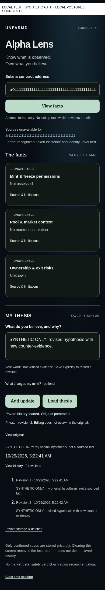

# Thesis Save/Load slice — review only, hosted storage OFF

Dependent on exact #226 `4af9532709c3a9bca9efe71356124328955a2877`, not main.
Original H/J/P histories and source hashes remain ancestors; collector bytes/modes,
source/STOP/admission controls, A's owner/pilot modules and J's crypto/schema/auth/
repository are unchanged. No issuer, login, key loader, hosted pool or Save is
configured. Production routes unconditionally return503 storage_off before
reading request, environment, auth, secrets or DB. /lens still defaults OFF and
NOT SAVED. No env, query flag or client capability can enable a hosted write.

## Actual implemented seam and flow

`createThesisHandler({origin,owners,authority,repository,rate})` is an unconnected
server-only injection seam. A later reviewed integration supplies A#227's opaque
verified owner, issuer/audience/session, immutable ONE-owner allowlist, signed
HttpOnly cookie, revocation, CSRF and genuine J principal mapping. B does not
invent an issuer, trust an email/wallet/header or cast A's context to J's principal.
`owner-context.ts` is a B-side typed adapter proposal coordinated on #227; it is
not a replacement for A. `owner-adapter.ts` structurally consumes the published
A#229 verify/inspect contract at `7a1409581a482580ad9ba82d7adf2d22b92b328a`,
without copying its opaque brand. It re-verifies the original request around I/O,
requires the identical owner/journal mapping/session/issuer/audience, and invokes
an injected legitimate J capability mapper and CSRF verifier. No cast or new B
issuer is provided. No live A adapter is installed. A currently permits POST only:
GET/PATCH correctly fail closed until A reviews a journal-specific genuine method
policy. B never rewrites a GET/PATCH to a fake POST or forges Origin. Its1-second
capability is refreshed through verification, not cached as a durable identity.
Actual principal mint/mapping and session-CSRF issuance remain explicit HOLDs. The synthetic fixture uses J's actual Ed25519 verifier and
authority-bound capability, generated ephemeral keys and fake local sessions only.

|Method/path|Bounded operation|
|---|---|
|GET /api/v4/theses?mint=exact|Matching exact mint within latest20 owner journals; explicitly incomplete recent list|
|POST /api/v4/theses|Create original; client-generated UUID/idempotency key, exact mint, thesis, optional invalidation|
|GET /api/v4/theses/:id?mint=exact|Authenticated J read/replay; max64 revisions, original UTC timestamps/hash/supersedes preserved|
|PATCH /api/v4/theses/:id|Append revision with CAS and request UUID, or deletion request that revokes and queues erasure|

No other method, source acquisition, arbitrary URL, owner parameter or public note
link. No CORS grants. Fixed configured origin, Fetch Metadata and write Origin
and explicit journal-intent checks precede authentication; every write additionally requires A's session-bound
CSRF verifier. Context validity is checked before I/O and before returning private
data, with the real J capability independently validated by its own authority.
Forged/nonowner/revoked sessions deny before keys/DB. No client principal/session
tag is accepted or returned. A browser capability carries only expiry/CSRF, never
the server capability. In-flight auth revocation is not atomic with PostgreSQL:
an already-authorized write can commit before the final revocation check. Its
response is denied and the result is uncertain; no false unsaved/deleted claim.
The eventual issuer/DB integration must explicitly review this boundary.

Bodies are strict duplicate-key JSON/UTF8, max16KiB,256 chunks/1.5s; unknown keys,
compression, aliases/whitespace mints, owner overrides and duplicate queries deny.
Thesis max2,000 chars/invalidation1,000; all original J limits still apply. Auth/
CSRF/current/rate waits are bounded and do not retry. Every response is private,
no-store, no-referrer/nosniff; fixed errors never echo notes, SQL, keys or tokens.
No server action, telemetry, third-party data call or browser Storage/IndexedDB.

Durable new PostgreSQL rate schema (uninstalled) commits each owner ticket before
journal I/O: max60 reads and20 writes/hour across processes. Time is sampled after
the owner-row lock; clock regression denies. A bounded hourly rollover is API
rate policy, not reset of source or J lifetime quotas. App role can only execute
the fixed reserve function; no table UPDATE/reset. No memory fallback/refund or
automatic retry on uncertain ACK. Abuse/global request admission, production
connection bounds and beta owner count still require owner review before exposure.
Rate-owner UUID metadata retention and deletion must join the real privacy policy;
no erasure of quota state is promised. No paid service or quota is activated.

## Minimal UI and truthful outcomes

Hosted OFF layout/text remains the original one-CA, three grey groups and unsaved
thesis. No Save, Load, history button or API request appears. In the injected
authenticated local harness, the same actual Lens/controls show Save thesis,
Load thesis, then Add update and folded View original/history. Only an actual
committed repository receipt yields SAVED; edits remain unsaved until confirmed.
Original text is immutable; Add update records a new revision. UTC timestamps
remain in time datetime attributes/API, with readable local display. History and
deletion/backup/PITR qualification are folded rather than a new dashboard/form.

A failed/ambiguous write never fabricates success or automatically retries. UI
keeps the exact target ID, blocks another Save and requires deliberate Load to
recover the real committed receipt. Conflict preserves the draft and asks for a
fresh Load. Expired/revoked/missing journal is one non-leaking unavailable response.
401/403 clears private loaded text/history. Session expiry, pagehide/bfcache,
mint change and Clear discard the local view/receipt and abort pending requests;
they do not delete server history. Browser/OS copies and already-returned plaintext
cannot be clawed back. Explicit Load replaces the current editor draft.

Existing bounded list20 can omit an older matching journal; UI says that rather
than claiming no history exists. This first slice has no unbounded list, full
catalog search, public sharing or durable client anchor store. J's valid-prefix
rollback limitation remains: an independent trusted anchor is required to detect
a privileged database restore to an otherwise valid prefix. Keys, backups, PITR,
tombstone retention and actual erasure monitoring are not activated or attested.

## Genuine local evidence / limitations

`bash tests/v4-thesis/run.sh` runs actual Request/Response → owner-port checks →
native verified TLS PostgreSQL rate+J transactions, generated ephemeral keys and
explicit SYNTHETIC prose. `bash tests/v4-thesis/run.sh browser` builds actual React
Lens/controls using the existing pinned Next webpack and drives the local API/PG
at320/390/1280. The test-only server is loopback, never an app route/build import.
Fake sessions are not real issuer acceptance. No secret or actual user note is a
fixture/artifact. Images are direct browser captures, not edited graphics:

Critical review: Save/Load are two compact actions; original/history are one tap
deeper. The original three grey cards still push My thesis below the first mobile
viewport; no claim of one-screen fit or uncoached physical iPhone acceptance.
Expanded original and history repeat the original on purpose for review, not a
collapsed default wall of text. No factual market/source activity is shown.

Five exact replacement patches are recorded with original/reviewed/full-diff
hashes: Lens view and four scope/reviewer compatibility paths.30 named additions,
no directory/flag waiver. An outer reviewer freezes every other226 blob/mode and
every original manifest. The original reviewer still checks original versions of
those specifically replaced paths while independently pinning their live new
patches; unchanged current paths remain checked directly. All original source
guards execute, plus unchanged226/J/P/A/B/C guards in exact detached trees. No
legacy test is removed/skipped. New mutation controls pass before tampering.

## Founder acceptance and GO/HOLD

**GO: offline engineering review only. HOLD: every hosted Save/auth/DB/source.**

1. Review exact dependent SHA, all CI and the30-addition/five-patch manifest; do not
   merge into main or activate storage. Confirm no Agent A auth/pilot module edits.
2. Review A's actual verify/inspect capability and legitimate A→J mapping. No cast,
   client-subject shortcut, mock session, Vercel badge or new B issuer is acceptable.
   Prove real configured issuer/allowlist/HttpOnly/session/CSRF/revocation separately.
3. Approve isolated J/rate schema SQL, least-privilege logins, native TLS/channel-
   binding transport, per-owner app keys and recovery, retention/PITR/tombstones,
   purge/monitoring and beta/global budgets. No SQL/secrets/provisioning here.
4. Only a distinct release may connect installed routes and server-issued client
   capability. Independently inspect protected immutable preview identity, auth
   and exceptions; normal desktop/iPhone login required, no bypass/share link.
5. On an authorized physical iPhone: enter one public exact CA; facts remain grey.
   Write an invented thesis → Save → reopen in second verified session → Load →
   View original → edit/Add update → compare history. Show that conflict/expiry/
   revocation and uncertain save do not falsely claim persistence/deletion.

Rollback now: close the dependent draft. Future authorized rollback disables new
access/writes but preserves latest collector data, ciphertext/keys, J/rate tickets,
tombstones and source/STOP history. No automatic DB restore/drop/key destruction
or retry/counter reset. No hosted/production success is inferred from local tests.
